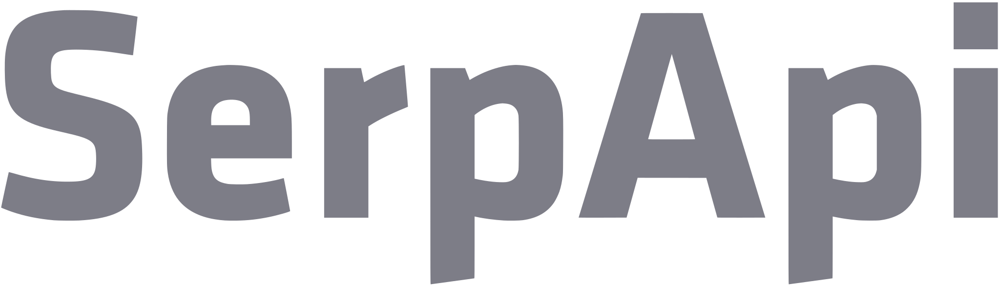
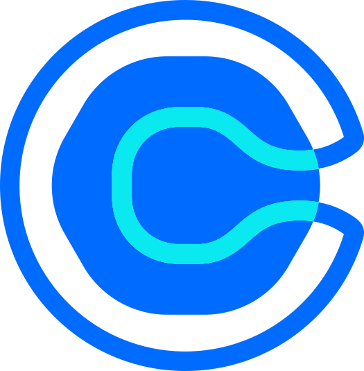
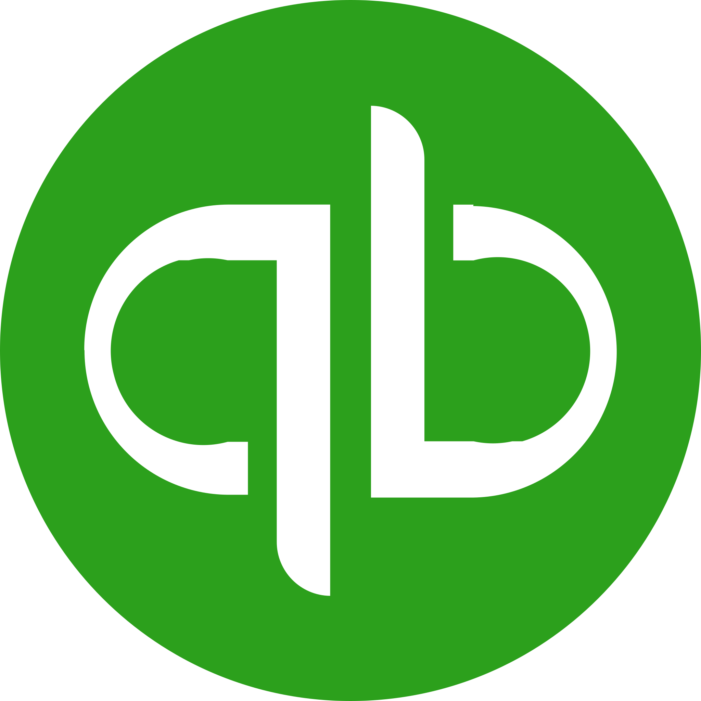

# n8n workflows, built to stay up

[](https://github.com/kimjoshuadr/n8n-workflows/actions/workflows/test.yml)

94 n8n workflows on 37 named platforms, written as code and run against a real n8n. 15 of them were built and run in production and are rebuilt here; the rest are reference builds: 4 multi-agent AI systems of 72 to 104 nodes each, 8 more complete systems, 21 single-purpose workflows and 28 building blocks.

Most workflow collections show the path where everything works. These are written for the other days: the webhook that arrives twice, the API that is down, the model that replies with something unreadable, the schedule that silently stops. **322 such behaviours are tested**, each by importing the workflow into n8n, sending it input and checking what it actually did.

## Built in production

> **What these are.** Workflows that were built and run in production, rebuilt here for publication and run on test data. Node names, order, branches and loops follow the original canvases. What is inside each node (prompts, field mappings, addresses, product and account names) was written again for this library, and every name that belonged to a business is a placeholder. Where a canvas could not be read node by node, the folder's README says so.

### [Newsletter research engine](production/newsletter-research)

Ten sources read, scraped and vetted by a model, every day. Each source is checked on a schedule, every article is read in full, a model keeps only what is relevant to the audience, and the result is stored as Markdown ready for drafting.

- **Size:** 65 nodes, 9 tested behaviours
- **Platforms:**  Supabase &nbsp;·&nbsp;  Google Drive &nbsp;·&nbsp;  Gemini &nbsp;·&nbsp;  Groq &nbsp;·&nbsp;  RSS

### [Newsletter drafting engine](production/newsletter-drafting)

From a day's research to a draft, with the editor approving each step. The stored research becomes proposed stories and a subject line, the editor's feedback on Telegram is applied until they approve, and a formatted draft arrives with a summary.

- **Size:** 69 nodes, 7 tested behaviours
- **Platforms:**  Supabase &nbsp;·&nbsp;  Google Drive &nbsp;·&nbsp;  Telegram &nbsp;·&nbsp;  Gemini &nbsp;·&nbsp;  Groq

### [Revenue and support agent pipeline](production/revenue-support-agents)

Six agents: three answer the inbox, three run outbound. Inbound messages are routed, answered from the knowledge base and CRM or handed to a person with a brief. Outbound, agents find companies and people who fit the customer profile and write to them, with the profile and the email checked in code.

- **Size:** 49 nodes, 10 tested behaviours
- **Platforms:**  Slack &nbsp;·&nbsp;  HubSpot &nbsp;·&nbsp;  Gmail &nbsp;·&nbsp;  Supabase &nbsp;·&nbsp;  SerpAPI &nbsp;·&nbsp;  OpenAI

### [Social intelligence scraper](production/social-intelligence)

Five networks scraped each morning into the sheets a dashboard reads. Apify tasks collect the posts for every tracked account, each post is routed by account, and every record lands in one format in a Google Sheet that Tableau reads.

- **Size:** 47 nodes, 6 tested behaviours
- **Platforms:**  Google Sheets &nbsp;·&nbsp;  Apify

### [Community onboarding and provisioning](production/community-provisioning)

A Stripe charge becomes a user, Discord roles and a Skool invitation. The purchase is read from Stripe, the member is created or updated in Supabase, the Discord bot is given a secret code with the right roles, and a Skool invitation goes out for each tier.

- **Size:** 30 nodes, 6 tested behaviours
- **Platforms:**  Supabase &nbsp;·&nbsp;  Stripe &nbsp;·&nbsp;  Skool

**Single workflows**

- [Unified event API](production/operations): One web address that returns every active event. Google Sheets.
- [Post-purchase email](production/operations): When a Stripe checkout completes, reads the line items, checks which product was bought, and sends that product's email through SendGrid. Stripe, SendGrid.
- [Cross-team data sync](production/operations): On a schedule, reads claims and users from the Bubble app's database, joins and sorts them, then clears a shared Google Sheet and refills it, so people without database access always see current data.. Bubble, Google Sheets.
- [News to social content engine](production/social-content): A form request picks a media brand. RSS, Gemini, Telegram.
- [On-demand post generator](production/social-content): A form takes a topic, a prompt or a link and a media brand. Gemini, Telegram.
- [RSS to caption](production/social-content): Watches an RSS feed. RSS, Gemini, Telegram.
- [Markdown to blog draft](production/publishing): A Markdown file sent to a Telegram bot is turned into a blog post. Telegram, Apify, Gemini, Groq, Wix.
- [Bulk object creator](production/operations): One click reads every row of a sheet and creates an object in the Bubble database for each, one at a time.. Google Sheets, Bubble.
- [Database cleansing](production/operations): On demand, reads every object of one type from the Bubble database, keeps the first of each set of duplicates as the master, and deletes the rest.. Bubble.

## Reference builds

> **What these are.** Written for this library and run on test data. They are not copies of any client's system, and no client data is in this repository.

## The platforms

One named platform per job, used the same way in every workflow. Each step that touches a platform is that platform's own n8n node with its own credential, so the canvas shows its logo and the README of every workflow lists exactly what it connects to.

**Sales and marketing**

-  HubSpot: CRM. 10 workflows.
-  Calendly: Booking. 1 workflow.
-  Typeform: Forms. 2 workflows.
-  Mailchimp: Email marketing. 2 workflows.
-  Clearbit: Enrichment. 2 workflows.
-  SerpAPI: Web search. 6 workflows.
-  LinkedIn: Social. 2 workflows.
-  X: Social. 2 workflows.
-  Facebook: Social. 2 workflows.
-  WordPress: Website and CMS. 2 workflows.
-  Wix: Website and blog. 1 workflow.

**Support and community**

-  Zendesk: Helpdesk. 6 workflows.
-  Gmail: Shared inbox. 4 workflows.
-  Discord: Community. 3 workflows.
-  Skool: Paid community. 1 workflow.

**Messaging**

-  Slack: Team chat and alerts. 19 workflows.
-  Telegram: Review and approval chat. 5 workflows.
-  SendGrid: Customer email. 22 workflows.
-  Twilio: SMS. 1 workflow.

**Commerce and finance**

-  Shopify: Store. 3 workflows.
-  Stripe: Payments. 7 workflows.
-  QuickBooks: Accounting. 1 workflow.

**Operations and data**

-  Supabase: Records and state. 57 workflows.
-  Bubble: App database. 3 workflows.
-  Google Calendar: Calendar. 3 workflows.
-  Google Drive: Files. 3 workflows.
-  Google Sheets: Sheets. 5 workflows.
-  BambooHR: HR. 1 workflow.
-  PostHog: Product analytics. 2 workflows.
-  Apify: Web and social scraping. 2 workflows.
-  RSS: News feeds. 3 workflows.

**AI**

-  Claude: AI reasoning and writing. 8 workflows.
-  OpenAI: AI classification and embeddings. 17 workflows.
-  Gemini: AI writing and images. 6 workflows.
-  Groq: AI output repair. 3 workflows.
-  Pinecone: AI knowledge base. 4 workflows.
-  ElevenLabs: AI voice. 1 workflow.

### AI systems

Each is one canvas: several agents with their own tools, memory and knowledge base, checked by code and by a second model before anything reaches a customer. Claude does the reasoning and writing, OpenAI the classification and embeddings, Pinecone holds the knowledge base and ElevenLabs the voice.

#### [AI sales team](systems/ai-sales-team)

Seven agents run outbound, from research to booked call. Every lead is researched and scored, every email is written and reviewed by different models, and every reply is read and answered or handed to a person.

- **Size:** 104 nodes, 13 tested behaviours
- **Platforms:**  Slack &nbsp;·&nbsp;  HubSpot &nbsp;·&nbsp;  SendGrid &nbsp;·&nbsp;  Gmail &nbsp;·&nbsp;  Supabase &nbsp;·&nbsp;  Google Calendar &nbsp;·&nbsp;  Typeform &nbsp;·&nbsp;  Mailchimp &nbsp;·&nbsp;  Clearbit &nbsp;·&nbsp;  SerpAPI &nbsp;·&nbsp;  Claude &nbsp;·&nbsp;  OpenAI &nbsp;·&nbsp;  Pinecone

#### [AI support desk](systems/ai-support-desk)

A triage agent, four specialists and a judge on every ticket. Each ticket is triaged, answered by an agent that looks the facts up, judged by a second model, and audited overnight. Refunds follow a written policy and uncertain tickets reach a person with the facts attached.

- **Size:** 93 nodes, 14 tested behaviours
- **Platforms:**  Slack &nbsp;·&nbsp;  Supabase &nbsp;·&nbsp;  Zendesk &nbsp;·&nbsp;  Shopify &nbsp;·&nbsp;  Stripe &nbsp;·&nbsp;  Typeform &nbsp;·&nbsp;  Claude &nbsp;·&nbsp;  OpenAI &nbsp;·&nbsp;  Pinecone

#### [AI content studio](systems/ai-content-studio)

Research to published article, voice-over and social posts. Agents research, write, fact-check and optimise each piece. A person approves it, then it is published, voiced and shared, and its results come back as next week's brief.

- **Size:** 84 nodes, 13 tested behaviours
- **Platforms:**  Slack &nbsp;·&nbsp;  Supabase &nbsp;·&nbsp;  WordPress &nbsp;·&nbsp;  LinkedIn &nbsp;·&nbsp;  X &nbsp;·&nbsp;  Facebook &nbsp;·&nbsp;  SerpAPI &nbsp;·&nbsp;  PostHog &nbsp;·&nbsp;  Claude &nbsp;·&nbsp;  OpenAI &nbsp;·&nbsp;  Pinecone &nbsp;·&nbsp;  ElevenLabs

#### [AI back office](systems/ai-back-office)

Invoices, receipts and bank lines, read, matched and questioned. Documents are read by a model and checked by arithmetic, bank lines are matched, anomalies are raised, and finance can ask questions in Slack and get answers from the books.

- **Size:** 72 nodes, 13 tested behaviours
- **Platforms:**  Slack &nbsp;·&nbsp;  Gmail &nbsp;·&nbsp;  Supabase &nbsp;·&nbsp;  QuickBooks &nbsp;·&nbsp;  Google Sheets &nbsp;·&nbsp;  Claude &nbsp;·&nbsp;  OpenAI &nbsp;·&nbsp;  Pinecone

### Systems

#### [Lead intake](systems/lead-intake)

An enquiry followed from the form to a booked call.

- **Size:** 3 workflows, 43 nodes, 14 tested behaviours
- **Platforms:**  HubSpot &nbsp;·&nbsp;  SendGrid &nbsp;·&nbsp;  Supabase &nbsp;·&nbsp;  Calendly &nbsp;·&nbsp;  OpenAI

#### [Support agent](systems/support-agent)

Answers what it can, hands over what it cannot.

- **Size:** 3 workflows, 40 nodes, 11 tested behaviours
- **Platforms:**  Slack &nbsp;·&nbsp;  Supabase &nbsp;·&nbsp;  Zendesk &nbsp;·&nbsp;  Claude &nbsp;·&nbsp;  OpenAI

#### [Content pipeline](systems/content-pipeline)

Topic to published article, with a person's approval in the middle.

- **Size:** 3 workflows, 44 nodes, 11 tested behaviours
- **Platforms:**  Slack &nbsp;·&nbsp;  Supabase &nbsp;·&nbsp;  WordPress &nbsp;·&nbsp;  LinkedIn &nbsp;·&nbsp;  X &nbsp;·&nbsp;  Facebook &nbsp;·&nbsp;  SerpAPI &nbsp;·&nbsp;  Claude &nbsp;·&nbsp;  OpenAI

#### [Order operations](systems/order-ops)

An order followed from checkout to the customer's inbox.

- **Size:** 3 workflows, 32 nodes, 11 tested behaviours
- **Platforms:**  SendGrid &nbsp;·&nbsp;  Supabase &nbsp;·&nbsp;  Shopify

#### [Payments](systems/payments)

Every payment recorded exactly once, and checked daily.

- **Size:** 3 workflows, 36 nodes, 13 tested behaviours
- **Platforms:**  Slack &nbsp;·&nbsp;  SendGrid &nbsp;·&nbsp;  Supabase &nbsp;·&nbsp;  Stripe

#### [Community operations](systems/community-ops)

Welcoming, moderating and announcing on a Discord server.

- **Size:** 3 workflows, 39 nodes, 12 tested behaviours
- **Platforms:**  Supabase &nbsp;·&nbsp;  Discord &nbsp;·&nbsp;  OpenAI

#### [Ops digest](systems/ops-digest)

The week's numbers on one screen, and an alert when one breaks.

- **Size:** 2 workflows, 18 nodes, 6 tested behaviours
- **Platforms:**  Slack &nbsp;·&nbsp;  SendGrid &nbsp;·&nbsp;  Supabase &nbsp;·&nbsp;  PostHog &nbsp;·&nbsp;  Claude

#### [Reliability kit](shared)

What every other workflow leans on when something fails.

- **Size:** 6 workflows, 40 nodes, 16 tested behaviours
- **Platforms:**  Slack &nbsp;·&nbsp;  SendGrid &nbsp;·&nbsp;  Supabase

Each folder has a README with a diagram of every workflow, how it runs step by step, the platforms it touches and the behaviours it is tested for.

### Single-purpose workflows

**[Content](workflows/content)**

- Industry news digest: Supabase, Claude, SendGrid
- Broken link check: Supabase, Slack
- Keyword rank tracker: Supabase, SerpAPI
- Mention monitor: SerpAPI, Supabase, OpenAI

**[Commerce](workflows/commerce)**

- Supplier stock sync: Supabase, Shopify
- Refund requests: Supabase, Stripe
- Renewal reminders: Supabase, SendGrid
- Supplier invoice intake: OpenAI, Supabase

**[Operations](workflows/operations)**

- New hire onboarding: BambooHR, Supabase, Google Calendar, SendGrid
- Morning agenda: Google Calendar, Slack
- CRM to email list sync: Supabase, HubSpot, Mailchimp
- Expiry reminders: Supabase, SendGrid

**[Monitoring](workflows/monitoring)**

- Uptime checks: Supabase
- Backup verification: Supabase

**[Sales](workflows/sales)**

- Enrich new contacts: Clearbit, HubSpot
- Meeting notes and next steps: OpenAI, HubSpot
- Ask after delivery: Supabase, SendGrid
- Route survey scores: Supabase, Zendesk, SendGrid
- Webinar registration and reminders: Supabase, SendGrid

**[Support](workflows/support)**

- SLA breach watch: Zendesk
- Inbox triage and first reply: Gmail, OpenAI, SendGrid, Zendesk

### Building blocks

**[Intake](blocks/intake)**

- Webhook to a table: Supabase
- Webhook with a shared secret: logic only
- Validate and answer with field errors: logic only

**[Notify](blocks/notify)**

- Event to a chat message: Slack
- One event, three channels: Slack, SendGrid, Twilio
- Templated email: SendGrid

**[Schedule](blocks/schedule)**

- Scheduled count to chat: Supabase, Slack
- Check in with the heartbeat monitor: Supabase
- Working hours gate: logic only

**[Lists](blocks/lists)**

- Remove duplicates by key: logic only
- Read every page of an API: HubSpot
- Loop that respects a rate limit: SendGrid
- Upsert in chunks: Supabase

**[Reliability](blocks/reliability)**

- Retry with growing waits: logic only
- Failed call to dead letter: HubSpot
- Limit actions per key per hour: Supabase
- Wait for a person's yes: Supabase

**[Data](blocks/data)**

- CSV text to rows: logic only
- Has this changed since last time?: Supabase
- Convert a currency amount: Stripe
- Clean text into a URL slug: logic only
- Yesterday, in the business's time zone: logic only
- Incremental sync with a bookmark: Supabase, HubSpot
- Archive a Drive file once: Supabase, Google Drive

**[Ai](blocks/ai)**

- A model reply you can rely on: OpenAI
- Mask personal data before a model sees it: logic only
- Split a document into overlapping chunks: logic only
- Classify, then route: OpenAI

## What "built to stay up" means here

Every workflow follows the same rules, and the tests hold them to it.

- **Handled once.** Anything triggered from outside claims an idempotency key in Supabase before it acts. A repeated delivery changes nothing.
- **Failures have somewhere to go.** Calls to a platform retry three times. Writes that must not be lost take a failure branch into a dead-letter queue, which is replayed on a timer.
- **One alert, not a thousand.** Every workflow names the same error handler, which alerts in Slack once per distinct error per hour. Alerts fall back to email when Slack is down.
- **A model is never trusted with the outcome.** Model replies must arrive in a declared shape and are read defensively. Arithmetic, duplicate checks and policy rules are done in code. When a model is unavailable or unsure, the work goes to a person; nothing is deleted, refunded or published on a guess.
- **State lives in Supabase.** No workflow sleeps for days. Follow-ups, reminders and escalations are short scheduled runs that read where things stand.
- **Silence is checked too.** Scheduled workflows check in, and a monitor alerts when one stops.
- **No secrets in the repository.** Every platform is reached through an n8n credential that you create in your own instance. The files hold a placeholder where the credential goes.

## Use them

**Import one by hand.** Take the `.json` next to any workflow and import it in n8n. Import [`shared/`](shared) first, then replace each `__WF:name__` placeholder with the id of that workflow in your instance, and choose your own credential on each platform node.

**Or install with the script**, which does both for you:

```sh
npm ci
N8N_URL=https://your-n8n.example.com N8N_API_KEY=... npm run install-workflows -- ai-sales-team
```

It installs the system you name and everything it calls, in order, inactive. Where your instance already has a credential of the type a node needs, the node is pointed at it; the script lists the credential types that are still missing. Leave the name off to install the whole library.

**Then create the tables.** [`schema.sql`](schema.sql) holds the Supabase tables the workflows keep their state in, with the unique constraints that make a repeated run safe.

A few workflows also read a service that is the business's own and has no node: a supplier's stock feed, a backup report. Those addresses are environment variables, listed in [`.env.example`](.env.example).

## Run the tests

You need Docker and Node 22.

```sh
npm ci
npm run stack:up     # a throwaway n8n and a stand-in for every platform
npm test             # all 322 cases
npm test -- refund   # only workflows whose id contains "refund"
npm run stack:down
```

Nothing in a workflow is changed for testing. The stack answers on each platform's real hostname, so the Slack node believes it is talking to Slack and the agents believe they are talking to Claude and OpenAI. The runner imports each workflow, sends the case's input, waits for the execution and checks which nodes ran, what each platform received and what Supabase holds afterwards. Model replies are scripted per case, a person's tap or reply on Telegram is played by the stack, and any platform can be made to fail a set number of times, which is how the retry, fallback and dead-letter paths are exercised. Last full run: **322 passed, 0 failed on n8n 2.42.7** ([`test-results.json`](test-results.json)).

## How it is written

Workflows are defined in [`definitions/`](definitions) with a small vocabulary ([`lib/wf.mjs`](lib/wf.mjs) for logic, [`lib/nodes.mjs`](lib/nodes.mjs) for platforms and agents): name the nodes, then the wiring. The definition also holds the step-by-step explanation and the test cases, so the three cannot drift apart.

`npm run build` turns the definitions into:

- `<id>.json`, the importable workflow
- `<id>.workflow.ts`, the same workflow as a TypeScript file
- a README per folder, with Mermaid diagrams
- [`catalog.json`](catalog.json), the whole library as data
- this README, [`schema.sql`](schema.sql) and [`.env.example`](.env.example)

`npm run validate` checks every workflow against n8n's node schemas and scans for anything that looks like a secret. CI runs build, validate and the full test suite on every push.

Platform names and logos belong to their owners and are shown only to say what each workflow connects to.

## Licence

MIT.
