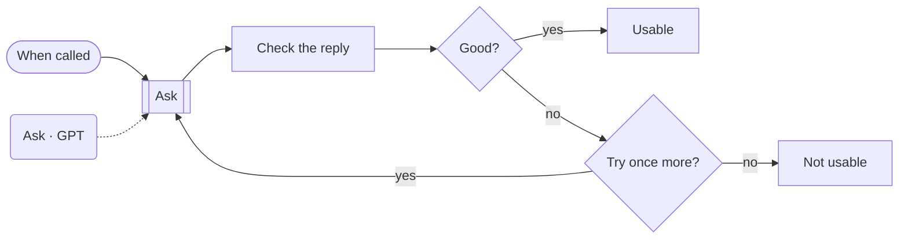
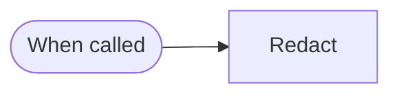
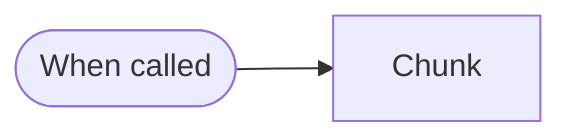
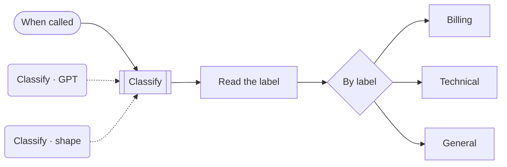

# Blocks · Ai

4 workflows. Each one is tested against a real n8n; the cases are listed under it.

## Block · A model reply you can rely on

Asks a model for JSON, checks the reply has the fields you need, asks once more if it does not, and then gives up honestly.

- **Starts from:** Called by another workflow
- **Platforms:**  OpenAI
- **Nodes:** 8
- **Calls:** `error-handler`
- **Files:** [`block-llm-json-guard.json`](block-llm-json-guard.json) · [`block-llm-json-guard.workflow.ts`](block-llm-json-guard.workflow.ts)

**Tested behaviour**

- accepts a complete reply first time
- asks once more, then gives up

## Block · Mask personal data before a model sees it

Replaces emails, phone numbers and card numbers with placeholders, and hands back the map to restore them afterwards.

- **Starts from:** Called by another workflow
- **Platforms:** none, logic only
- **Nodes:** 2
- **Calls:** `error-handler`
- **Files:** [`block-pii-redact.json`](block-pii-redact.json) · [`block-pii-redact.workflow.ts`](block-pii-redact.workflow.ts)

**Tested behaviour**

- masks an email, a card and a phone

## Block · Split a document into overlapping chunks

Cuts long text into chunks that end on sentence boundaries and overlap by whole sentences, ready for embedding or a model's context window.

- **Starts from:** Called by another workflow
- **Platforms:** none, logic only
- **Nodes:** 2
- **Calls:** `error-handler`
- **Files:** [`block-chunk-text.json`](block-chunk-text.json) · [`block-chunk-text.workflow.ts`](block-chunk-text.workflow.ts)

**Tested behaviour**

- splits on sentences and overlaps by a whole sentence

## Block · Classify, then route

Has a model put a message into one of a fixed set of labels and routes on it, with a default route for anything unexpected.

- **Starts from:** Called by another workflow
- **Platforms:**  OpenAI
- **Nodes:** 9
- **Calls:** `error-handler`
- **Files:** [`block-classify-route.json`](block-classify-route.json) · [`block-classify-route.workflow.ts`](block-classify-route.workflow.ts)

**Tested behaviour**

- routes a billing message
- an unexpected label takes the default route
- a model outage takes the default route
