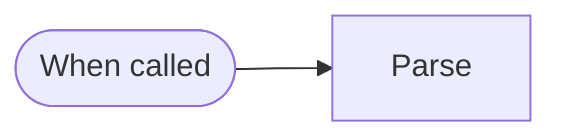
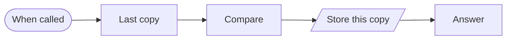
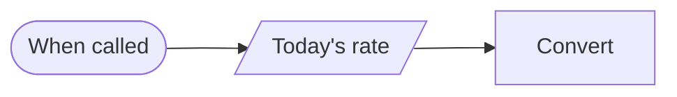
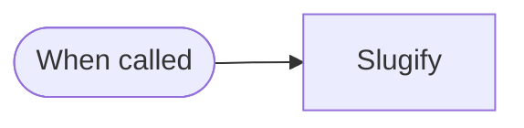
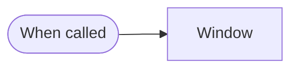
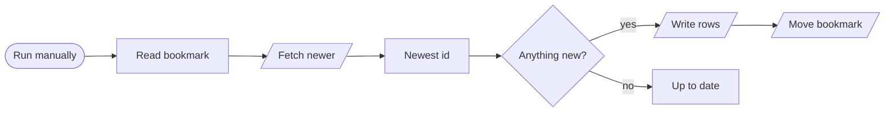
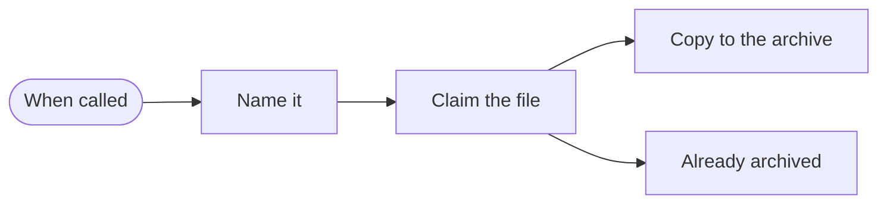

# Blocks · Data

7 workflows. Each one is tested against a real n8n; the cases are listed under it.

## Block · CSV text to rows

Parses CSV text properly, including quoted commas and blank lines, into one item per row.

- **Starts from:** Called by another workflow
- **Platforms:** none, logic only
- **Nodes:** 2
- **Calls:** `error-handler`
- **Files:** [`block-csv-to-rows.json`](block-csv-to-rows.json) · [`block-csv-to-rows.workflow.ts`](block-csv-to-rows.workflow.ts)

**Tested behaviour**

- handles quoted commas, escaped quotes and blank lines

## Block · Has this changed since last time?

Compares a record with the copy stored last run and reports which fields changed, so downstream work only happens on a real change.

- **Starts from:** Called by another workflow
- **Platforms:**  Supabase
- **Nodes:** 5
- **Calls:** `error-handler`
- **Files:** [`block-change-detect.json`](block-change-detect.json) · [`block-change-detect.workflow.ts`](block-change-detect.workflow.ts)

**Tested behaviour**

- names the field that changed
- an identical record is no change

## Block · Convert a currency amount

Converts an amount with today's rate, rounds like money, and says so when the rate could not be fetched instead of returning a wrong number.

- **Starts from:** Called by another workflow
- **Platforms:**  Stripe
- **Nodes:** 3
- **Calls:** `error-handler`
- **Files:** [`block-currency-convert.json`](block-currency-convert.json) · [`block-currency-convert.workflow.ts`](block-currency-convert.workflow.ts)

**Tested behaviour**

- converts and rounds to cents
- admits when there is no rate

## Block · Clean text into a URL slug

Turns any title into a safe, readable URL slug, including accented and non-Latin titles.

- **Starts from:** Called by another workflow
- **Platforms:** none, logic only
- **Nodes:** 2
- **Calls:** `error-handler`
- **Files:** [`block-slugify.json`](block-slugify.json) · [`block-slugify.workflow.ts`](block-slugify.workflow.ts)

**Tested behaviour**

- handles accents, symbols and empty results

## Block · Yesterday, in the business's time zone

Works out the start and end of 'yesterday' or 'last week' in a named time zone, which is where most reporting bugs come from.

- **Starts from:** Called by another workflow
- **Platforms:** none, logic only
- **Nodes:** 2
- **Calls:** `error-handler`
- **Files:** [`block-date-window.json`](block-date-window.json) · [`block-date-window.workflow.ts`](block-date-window.workflow.ts)

**Tested behaviour**

- Manila's yesterday is not UTC's yesterday

## Block · Incremental sync with a bookmark

The skeleton of every reliable sync: read the bookmark, fetch what is newer, write it, and only then move the bookmark.

- **Starts from:** Manual run
- **Platforms:**  Supabase &nbsp;·&nbsp;  HubSpot
- **Nodes:** 8
- **Calls:** `error-handler`
- **Files:** [`block-cursor-sync.json`](block-cursor-sync.json) · [`block-cursor-sync.workflow.ts`](block-cursor-sync.workflow.ts)

**Tested behaviour**

- moves the bookmark to the newest id
- leaves the bookmark when nothing is new

## Block · Archive a Drive file once

Copies a Google Drive file into the archive folder under a dated name, and records it so the same file sent twice is archived once.

- **Starts from:** Called by another workflow
- **Platforms:**  Supabase &nbsp;·&nbsp;  Google Drive
- **Nodes:** 5
- **Calls:** `error-handler`
- **Files:** [`block-file-to-storage.json`](block-file-to-storage.json) · [`block-file-to-storage.workflow.ts`](block-file-to-storage.workflow.ts)

**Tested behaviour**

- the same file is archived once
