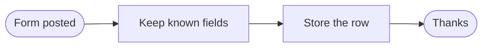
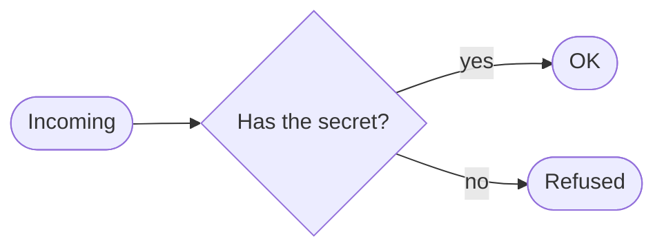
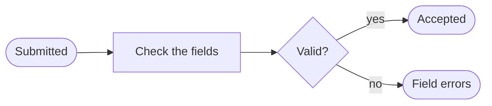

# Blocks · Intake

3 workflows. Each one is tested against a real n8n; the cases are listed under it.

## Block · Webhook to a table

The smallest useful workflow: receive a form post, keep the fields you named, store a row, answer the sender.

- **Starts from:** Webhook
- **Platforms:**  Supabase
- **Nodes:** 4
- **Calls:** `error-handler`
- **Files:** [`block-webhook-to-table.json`](block-webhook-to-table.json) · [`block-webhook-to-table.workflow.ts`](block-webhook-to-table.workflow.ts)

**Tested behaviour**

- stores named fields and drops the rest

## Block · Webhook with a shared secret

Refuses any request that does not carry the secret header, before doing anything else.

- **Starts from:** Webhook
- **Platforms:** none, logic only
- **Nodes:** 4
- **Calls:** `error-handler`
- **Files:** [`block-webhook-secret.json`](block-webhook-secret.json) · [`block-webhook-secret.workflow.ts`](block-webhook-secret.workflow.ts)

**Tested behaviour**

- accepts the right secret
- refuses a wrong one

## Block · Validate and answer with field errors

Checks a payload against simple rules and answers with exactly which fields were wrong, so the form can show it.

- **Starts from:** Webhook
- **Platforms:** none, logic only
- **Nodes:** 5
- **Calls:** `error-handler`
- **Files:** [`block-validate-respond.json`](block-validate-respond.json) · [`block-validate-respond.workflow.ts`](block-validate-respond.workflow.ts)

**Tested behaviour**

- names each wrong field
- accepts a good payload
