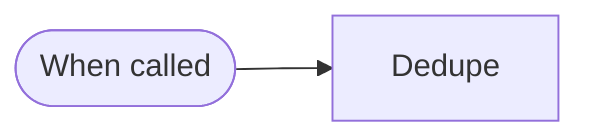
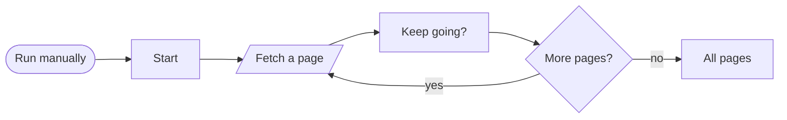
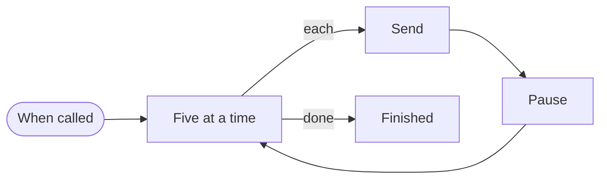

# Blocks · Lists

4 workflows. Each one is tested against a real n8n; the cases are listed under it.

## Block · Remove duplicates by key

Keeps the first of each item sharing a key, after normalising it, so 'A@B.co ' and 'a@b.co' count as one.

- **Starts from:** Called by another workflow
- **Platforms:** none, logic only
- **Nodes:** 2
- **Calls:** `error-handler`
- **Files:** [`block-dedupe.json`](block-dedupe.json) · [`block-dedupe.workflow.ts`](block-dedupe.workflow.ts)

**Tested behaviour**

- treats differently-cased emails as one

## Block · Read every page of an API

Follows a cursor until the API says there is no more, with a hard stop so a broken API cannot loop forever.

- **Starts from:** Manual run
- **Platforms:**  HubSpot
- **Nodes:** 6
- **Calls:** `error-handler`
- **Files:** [`block-paginate.json`](block-paginate.json) · [`block-paginate.workflow.ts`](block-paginate.workflow.ts)

**Tested behaviour**

- stops when there is no next cursor

## Block · Loop that respects a rate limit

Sends items in small batches with a pause between them, for APIs that reject bursts.

- **Starts from:** Called by another workflow
- **Platforms:**  SendGrid
- **Nodes:** 5
- **Calls:** `error-handler`
- **Files:** [`block-rate-limited-loop.json`](block-rate-limited-loop.json) · [`block-rate-limited-loop.workflow.ts`](block-rate-limited-loop.workflow.ts)

**Tested behaviour**

- sends every item across batches

## Block · Upsert in chunks

Groups a long list into chunks of 100 and upserts each chunk in one request.

- **Starts from:** Called by another workflow
- **Platforms:**  Supabase
- **Nodes:** 3
- **Calls:** `error-handler`
- **Files:** [`block-batch-upsert.json`](block-batch-upsert.json) · [`block-batch-upsert.workflow.ts`](block-batch-upsert.workflow.ts)

**Tested behaviour**

- 250 rows become three requests and update on repeat
