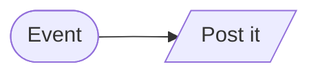
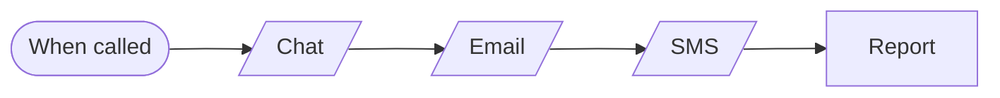
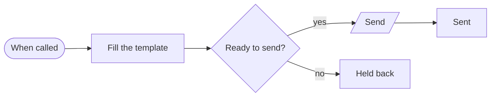

# Blocks · Notify

3 workflows. Each one is tested against a real n8n; the cases are listed under it.

## Block · Event to a chat message

Turns any event into one readable chat message.

| | |
|---|---|
| Starts from | Webhook |
| Platforms | Chat |
| Nodes | 2 |
| Calls | `error-handler` |
| Files | [`block-webhook-to-chat.json`](block-webhook-to-chat.json) · [`block-webhook-to-chat.workflow.ts`](block-webhook-to-chat.workflow.ts) |

**Tested behaviour**

- posts the title and text

## Block · One event, three channels

Sends the same message by chat, email and SMS, where each channel failing leaves the other two untouched.

| | |
|---|---|
| Starts from | Called by another workflow |
| Platforms | Chat, Email, SMS |
| Nodes | 5 |
| Calls | `error-handler` |
| Files | [`block-fan-out.json`](block-fan-out.json) · [`block-fan-out.workflow.ts`](block-fan-out.workflow.ts) |

**Tested behaviour**

- sends all three
- an email outage does not stop chat or SMS

## Block · Templated email

One place to send an email from: fills a template, refuses to send with a placeholder left unfilled.

| | |
|---|---|
| Starts from | Called by another workflow |
| Platforms | Email |
| Nodes | 6 |
| Calls | `error-handler` |
| Files | [`block-template-email.json`](block-template-email.json) · [`block-template-email.workflow.ts`](block-template-email.workflow.ts) |

**Tested behaviour**

- fills and sends
- holds back an email with a blank placeholder
