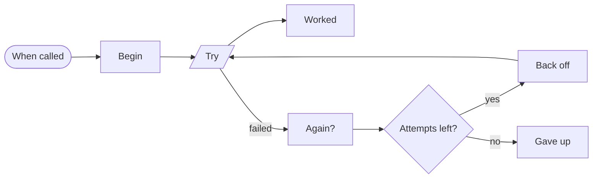
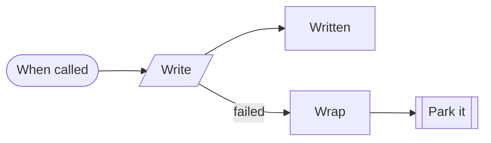
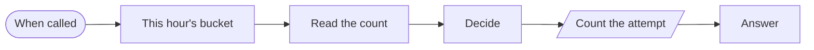
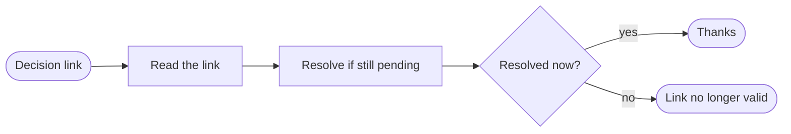

# Blocks · Reliability

4 workflows. Each one is tested against a real n8n; the cases are listed under it.

## Block · Retry with growing waits

Calls an address up to four times, waiting longer each time, and reports clearly whether it finally worked.

- **Starts from:** Called by another workflow
- **Platforms:** none, logic only
- **Nodes:** 8
- **Calls:** `error-handler`
- **Files:** [`block-retry-backoff.json`](block-retry-backoff.json) · [`block-retry-backoff.workflow.ts`](block-retry-backoff.workflow.ts)

**Tested behaviour**

- succeeds on the third attempt
- gives up after four

## Block · Failed call to dead letter

The pattern for any write that must not be lost: try, and if it still fails after retries, park the payload.

- **Starts from:** Called by another workflow
- **Platforms:**  HubSpot
- **Nodes:** 5
- **Calls:** `dead-letter`, `error-handler`
- **Files:** [`block-error-to-dead-letter.json`](block-error-to-dead-letter.json) · [`block-error-to-dead-letter.workflow.ts`](block-error-to-dead-letter.workflow.ts)

**Tested behaviour**

- writes when the service is up
- parks the payload when it stays down

## Block · Limit actions per key per hour

Answers whether a key (a user, an IP, a customer) is still under its hourly limit, and counts the attempt.

- **Starts from:** Called by another workflow
- **Platforms:**  Supabase
- **Nodes:** 6
- **Calls:** `error-handler`
- **Files:** [`block-throttle.json`](block-throttle.json) · [`block-throttle.workflow.ts`](block-throttle.workflow.ts)

**Tested behaviour**

- allows up to the limit, then refuses

## Block · Wait for a person's yes

Records a pending decision and gives back approve and reject links. Nothing proceeds until one is pressed, and each link works once.

- **Starts from:** Webhook
- **Platforms:**  Supabase
- **Nodes:** 6
- **Calls:** `error-handler`
- **Files:** [`block-approval-gate.json`](block-approval-gate.json) · [`block-approval-gate.workflow.ts`](block-approval-gate.workflow.ts)

**Tested behaviour**

- a link works once
- an unknown token is refused
