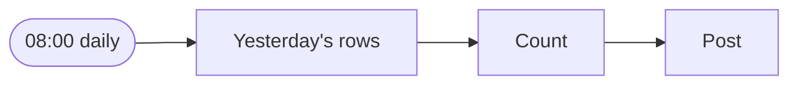
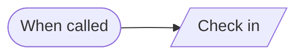
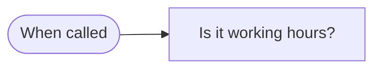

# Blocks · Schedule

3 workflows. Each one is tested against a real n8n; the cases are listed under it.

## Block · Scheduled count to chat

Every morning, counts yesterday's rows in a table and posts the number.

- **Starts from:** Schedule
- **Platforms:**  Supabase &nbsp;·&nbsp;  Slack
- **Nodes:** 4
- **Calls:** `error-handler`
- **Files:** [`block-scheduled-report.json`](block-scheduled-report.json) · [`block-scheduled-report.workflow.ts`](block-scheduled-report.workflow.ts)

**Tested behaviour**

- counts rows
- reports zero and does not go silent

## Block · Check in with the heartbeat monitor

What a scheduled workflow calls when it finishes, so the heartbeat monitor can tell when it stops running.

- **Starts from:** Called by another workflow
- **Platforms:**  Supabase
- **Nodes:** 2
- **Calls:** `error-handler`
- **Files:** [`block-heartbeat.json`](block-heartbeat.json) · [`block-heartbeat.workflow.ts`](block-heartbeat.workflow.ts)

**Tested behaviour**

- writes a heartbeat row

## Block · Working hours gate

Tells a caller whether now is inside working hours in a given time zone, so messages to people wait for the morning.

- **Starts from:** Called by another workflow
- **Platforms:** none, logic only
- **Nodes:** 2
- **Calls:** `error-handler`
- **Files:** [`block-working-hours.json`](block-working-hours.json) · [`block-working-hours.workflow.ts`](block-working-hours.workflow.ts)

**Tested behaviour**

- Tuesday 10:00 in Manila is open
- the same instant in New York is closed
- a Saturday is closed
