# Community onboarding and provisioning

**A Stripe charge becomes a user, Discord roles and a Skool invitation.**

**The problem.** Every purchase meant someone checking what was bought, updating the member's record, granting Discord roles and sending the right Skool invitation by hand.

**What this does about it.** The purchase is read from Stripe, the member is created or updated in Supabase, the Discord bot is given a secret code with the right roles, and a Skool invitation goes out for each tier.

One canvas of 30 nodes, 6 tested behaviours. Import the [reliability kit](../../shared) first: these workflows call it.

> **Built and run in production, rebuilt here on test data.** Node names, order, branches and loops follow the original canvas. What is inside each node was written again for this library, and every name that belonged to the business is a placeholder. The canvas has three sections, kept here. Its nodes could not all be read from the screenshot, so the steps inside each section follow the written description of the workflow.

## Community · Onboarding and provisioning

When a Stripe charge succeeds, reads what was bought, creates or updates the buyer in Supabase, stores a secret code that the Discord bot exchanges for the right roles, and sends a Skool invitation for each community tier in the purchase.

- **Starts from:** Stripe event
- **Platforms:**  Stripe &nbsp;·&nbsp;  Supabase &nbsp;·&nbsp;  Skool
- **Nodes:** 30
- **Calls:** `error-handler`
- **Files:** [`community-provisioning.json`](community-provisioning.json) · [`community-provisioning.workflow.ts`](community-provisioning.workflow.ts)

```mermaid
flowchart LR
  namdhu7(["on_charge_succeeded"])
  nrj9r71[/"get_checkout_session"/]
  nepr7k5[/"get_line_items"/]
  n1gbo5c1["split_line_items"]
  n1awbugq["filter_community_products"]
  n1g24oji["set_community_access"]
  n1borqho["filter_bot_products"]
  n1ucb5wg["set_bot_access"]
  ng19bv6["merge_products"]
  n1vt0sa3["aggregate_products"]
  n1rfquen["set_buyer"]
  n10jft3v["get_user"]
  n68bzhg{"if_existing_user"}
  n1qnr9h7["set_existing_user"]
  n1hnnwlq["set_new_user"]
  n1m1uw1l["merge_user"]
  nktu02h["generate_secret_code"]
  n11t0aqr["prepare_access"]
  n59uc8k[/"upsert_user"/]
  nz78hp3{"if_bot_access"}
  n1o32d93["store_secret_code"]
  nm30kwe{"if_community"}
  n1b5qgxy["set_invites"]
  n1qvwce6["split_invites"]
  nc4sxpm["for_each_invite"]
  n1e5qrae{"switch_tier"}
  n8q4omv[/"invite_skool_standard"/]
  n1hw00f1[/"invite_skool_premium"/]
  n14c9jmz["log_invite"]
  ncqk913["update_user_status"]
  namdhu7 --> nrj9r71
  nrj9r71 --> nepr7k5
  nepr7k5 --> n1gbo5c1
  n1gbo5c1 --> n1awbugq
  n1awbugq --> n1g24oji
  n1g24oji --> ng19bv6
  n1gbo5c1 --> n1borqho
  n1borqho --> n1ucb5wg
  n1ucb5wg --> ng19bv6
  ng19bv6 --> n1vt0sa3
  n1vt0sa3 --> n1rfquen
  n1rfquen --> n10jft3v
  n10jft3v --> n68bzhg
  n68bzhg --> n1qnr9h7
  n1qnr9h7 --> n1m1uw1l
  n68bzhg --> n1hnnwlq
  n1hnnwlq --> n1m1uw1l
  n1m1uw1l --> nktu02h
  nktu02h --> n11t0aqr
  n11t0aqr --> n59uc8k
  n59uc8k --> nz78hp3
  nz78hp3 --> n1o32d93
  n59uc8k --> nm30kwe
  nm30kwe --> n1b5qgxy
  n1b5qgxy --> n1qvwce6
  n1qvwce6 --> nc4sxpm
  nc4sxpm -->|each| n1e5qrae
  n1e5qrae --> n8q4omv
  n8q4omv --> n14c9jmz
  n1e5qrae --> n1hw00f1
  n1hw00f1 --> n14c9jmz
  n14c9jmz --> nc4sxpm
  nc4sxpm -->|done| ncqk913
```

**How it runs**

1. **A charge succeeds.** Stripe sends the charge. It does not say what was bought, so the workflow finds the checkout it belongs to and reads its line items.
2. **Each product is sorted.** Community memberships go one way and bot access the other. Each is labelled with what it grants: a tier and its Skool group, or a Discord role.
3. **New buyer or returning one.** The buyer is looked up in Supabase by email. A returning buyer keeps what they already own and the new products are added to it.
4. **A secret code for the bot.** A random code is generated for this purchase, and everything it grants is gathered into one record.
5. **The database is updated.** The user is created or updated. If the purchase includes bot access, the code and its roles are stored where the Discord bot reads them, so the member can redeem the code for the right roles.
6. **One invitation per tier.** Each community tier in the purchase gets its own Skool invitation to its own group, sent one at a time and logged.
7. **The user is marked invited.** Once every invitation has gone, the user's record says so.

**Tested behaviour**

- a new buyer gets a user record, a bot code and a Skool invitation
- a returning buyer keeps what they own and gains the new product
- two tiers in one purchase send two invitations to two groups
- bot access alone stores a 32-character code and sends no invitation
- a purchase of something else changes nothing
- retries the invitation when Skool is briefly down
