# Newsletter drafting engine

**From a day's research to a draft, with the editor approving each step.**

**The problem.** Each issue began with a blank page: reading the day's research, choosing stories, writing a subject line and formatting the draft.

**What this does about it.** The stored research becomes proposed stories and a subject line, the editor's feedback on Telegram is applied until they approve, and a formatted draft arrives with a summary.

One canvas of 69 nodes, 7 tested behaviours. Import the [reliability kit](../../shared) first: these workflows call it.

> **Built and run in production, rebuilt here on test data.** Node names, order, branches and loops follow the original canvas. What is inside each node was written again for this library, and every name that belonged to the business is a placeholder. The canvas was photographed in pieces and its model nodes were out of frame: Gemini and Groq are the models named on the blog workflow from the same team.

## Newsletter · AI drafting engine

For a chosen date, gathers that day's stored research, proposes the top stories and a subject line, and takes the editor's written feedback on each over Telegram until they approve. It then writes each story from its research and outside sources, adds an intro and a round-up, and sends the editor a draft file with a summary.

- **Starts from:** Form
- **Platforms:**  Google Drive &nbsp;·&nbsp;  Supabase &nbsp;·&nbsp;  Telegram &nbsp;·&nbsp;  Gemini &nbsp;·&nbsp;  Groq
- **Nodes:** 69
- **Calls:** `scrape-page`, `error-handler`
- **Files:** [`newsletter-drafting.json`](newsletter-drafting.json) · [`newsletter-drafting.workflow.ts`](newsletter-drafting.workflow.ts)

```mermaid
flowchart LR
  nftls10(["submit_form"])
  n1v1i2w7["get_files"]
  nqnov1e["filter_only_markdown"]
  n1mfjyy6["get_markdown_object_info"]
  nd276vi["exclude_newsletters"]
  n4kl59b["download_markdown_object"]
  ncyxp6e["get_markdown_file_content"]
  nkq7syw["prepare_markdown_content"]
  nuvjl68["aggregate_markdown_content"]
  nbq2lgw["combine_markdown_content"]
  ns2o6tz["stories_prompt"]
  nfqnv6[["pick_top_stories"]]
  ngvl397[["edit_top_stories"]]
  nawx6bt["set_current_stories"]
  nusojbq["share_selected_stories"]
  np1jogp["split_into_chunks"]
  n8489gr["share_stories_reasoning"]
  n1c01gwe["share_stories_approval_feedback"]
  nx50dyo[["extract_stories_approval_feedback"]]
  n1yc0jyn{"check_stories_feedback"}
  n1737z0j["subject_examples"]
  nl95ik8["set_subject_line_prompt"]
  nu3wf66[["write_subject_line"]]
  n1bra0wl[["edit_subject_line"]]
  n1p1bks1["set_current_subject_line"]
  nvzy766["share_subject_line"]
  n71cfsd["share_subject_line_reasoning"]
  npfps["share_subject_line_approval_feedback"]
  n19ytuem[["extract_subject_line_approval_feedback"]]
  nrisvnj{"check_subject_line_feedback"}
  n13x6u7n["set_selected_stories"]
  n1yc7rlz["split_stories"]
  n17evulj["iterate_stories"]
  n3or7zd["set_current_segment"]
  n1cro4di["split_content_ids"]
  ndopw28["get_segment_content_info"]
  njghtst["get_segment_content"]
  na6vph9["download_segment_content"]
  ndowqof["get_segment_content_text"]
  n988d44["prepare_segment_content_item"]
  nth2bsq["aggregate_segment_text_content"]
  nb1hda2{"check_external_urls"}
  nttnrjt["set_segment_external_source_links"]
  n11xvbvw["split_segment_external_source_urls"]
  n1bzno1b[["scrape_segment_external_source_url"]]
  n1rj88br["filter_segment_external_source_errors"]
  n1h9odjq["aggregate_segment_external_source_content"]
  n1ihyzq[["write_segment_content"]]
  nc1udki("story_segment_auto_parser")
  n1xekjc0("story_segment_output_parser")
  nuzy77x[["extract_image_urls"]]
  n1a71fr3("image_urls_auto_parser")
  n1kjc2vl("extract_image_urls_parser")
  n17d6y26["share_segment_msg"]
  ne8uqw5["set_story_segment"]
  n17t7cf9[["write_intro"]]
  n19kgfg5("intro_auto_parser")
  n1lrq8yh("intro_parser")
  n1fzvb03[["write_other_top_stories"]]
  nsiljwj("other_top_stories_auto_parser")
  n16x5fez("other_top_stories_parser")
  n1uxfrqd["set_full_newsletter"]
  n1fi3dfq["create_newsletter_file"]
  n1i4l4uj["upload_newsletter_file"]
  n16knaoy["share_newsletter_msg"]
  n1hk4mq4("Google Gemini Chat Model")
  nrtdpw2("stories_parser")
  n1bmj74g("subject_line_parser")
  n1mkyatp("Groq Chat Model")
  nftls10 --> n1v1i2w7
  n1v1i2w7 --> nqnov1e
  nqnov1e --> n1mfjyy6
  n1mfjyy6 --> nd276vi
  nd276vi --> n4kl59b
  n4kl59b --> ncyxp6e
  ncyxp6e --> nkq7syw
  nkq7syw --> nuvjl68
  nuvjl68 --> nbq2lgw
  nbq2lgw --> ns2o6tz
  ns2o6tz --> nfqnv6
  nfqnv6 --> nawx6bt
  nawx6bt --> nusojbq
  nusojbq --> np1jogp
  np1jogp --> n8489gr
  n8489gr --> n1c01gwe
  n1c01gwe --> nx50dyo
  nx50dyo --> n1yc0jyn
  n1yc0jyn --> ngvl397
  ngvl397 --> nawx6bt
  n1yc0jyn --> n1737z0j
  n1737z0j --> nl95ik8
  nl95ik8 --> nu3wf66
  nu3wf66 --> n1p1bks1
  n1p1bks1 --> nvzy766
  nvzy766 --> n71cfsd
  n71cfsd --> npfps
  npfps --> n19ytuem
  n19ytuem --> nrisvnj
  nrisvnj --> n1bra0wl
  n1bra0wl --> n1p1bks1
  nrisvnj --> n13x6u7n
  n13x6u7n --> n1yc7rlz
  n1yc7rlz --> n17evulj
  n17evulj -->|each| n3or7zd
  n3or7zd --> n1cro4di
  n1cro4di --> ndopw28
  ndopw28 --> njghtst
  njghtst --> na6vph9
  na6vph9 --> ndowqof
  ndowqof --> n988d44
  n988d44 --> nth2bsq
  nth2bsq --> nb1hda2
  nb1hda2 --> nttnrjt
  nttnrjt --> n11xvbvw
  n11xvbvw --> n1bzno1b
  n1bzno1b --> n1rj88br
  n1rj88br --> n1h9odjq
  n1h9odjq --> n1ihyzq
  nb1hda2 --> n1ihyzq
  n1ihyzq --> nuzy77x
  nuzy77x --> n17d6y26
  n17d6y26 --> ne8uqw5
  ne8uqw5 --> n17evulj
  n17evulj -->|done| n17t7cf9
  n17t7cf9 --> n1fzvb03
  n1fzvb03 --> n1uxfrqd
  n1uxfrqd --> n1fi3dfq
  n1fi3dfq --> n1i4l4uj
  n1i4l4uj --> n16knaoy
  nc1udki -.-> n1ihyzq
  n1xekjc0 -.-> nc1udki
  n1a71fr3 -.-> nuzy77x
  n1kjc2vl -.-> n1a71fr3
  n19kgfg5 -.-> n17t7cf9
  n1lrq8yh -.-> n19kgfg5
  nsiljwj -.-> n1fzvb03
  n16x5fez -.-> nsiljwj
  n1hk4mq4 -.-> nfqnv6
  n1hk4mq4 -.-> ngvl397
  n1hk4mq4 -.-> nu3wf66
  n1hk4mq4 -.-> n1bra0wl
  n1hk4mq4 -.-> n1ihyzq
  n1hk4mq4 -.-> nuzy77x
  n1hk4mq4 -.-> n17t7cf9
  n1hk4mq4 -.-> n1fzvb03
  n1hk4mq4 -.-> nx50dyo
  n1hk4mq4 -.-> n19ytuem
  nrtdpw2 -.-> nfqnv6
  nrtdpw2 -.-> ngvl397
  n1bmj74g -.-> nu3wf66
  n1bmj74g -.-> n1bra0wl
  n1mkyatp -.-> nc1udki
  n1mkyatp -.-> n1a71fr3
  n1mkyatp -.-> n19kgfg5
  n1mkyatp -.-> nsiljwj
```

**How it runs**

1. **An editor picks a date.** The form takes the date of the issue and, if the editor wants, a focus for it.
2. **That day's research is gathered.** Google Drive is searched for the date's Markdown files and Supabase for their index rows. Past newsletters stored alongside the research are left out.
3. **Every document is read.** Each file is downloaded and its text extracted, then all of it is joined into one body of research, each document under its id.
4. **A thin day is handled.** With fewer than three documents, the prompt tells the model to choose fewer stories instead of padding the issue.
5. **The top stories are proposed.** Gemini chooses the stories, names the documents each draws on, and explains the selection.
6. **The editor sees the proposal and the reasoning.** The selection arrives on Telegram, followed by the reasoning, cut into parts if it is too long for one message.
7. **The run waits for a written reply.** The editor answers in their own words. A model reads the reply and decides one thing: approved, or what to change.
8. **Changes go round again.** If the editor asked for changes, the selection is revised with exactly that feedback and shown again. This repeats until they approve.
9. **The subject line gets the same treatment.** A subject line and preheader are written in the house style, shown with their reasoning, and revised on the editor's feedback until approved.
10. **Stories are written one at a time.** The approved stories are split up and taken in order.
11. **A story's own research is loaded.** Only the documents that story draws on are fetched again and read, so the model writes from the right material and nothing else.
12. **Outside sources are read too.** If the story names outside links, each is scraped in full. A link that fails to load is dropped and the story is still written.
13. **The story is written.** Gemini writes the headline and body and lists its sources, then a second pass pulls out any images in the research. An answer in the wrong shape is repaired by a second model on Groq.
14. **Each story is shared as it lands.** The finished story goes to Telegram straight away, so the editor reads along while the rest is written.
15. **An intro and a round-up.** With every story written, the intro is written from them, and the research that was not chosen becomes a short list of other things worth reading.
16. **The draft is delivered.** Everything is assembled into one Markdown file and sent to the editor on Telegram, followed by a summary of what is in it.

**Tested behaviour**

- drafts the issue and delivers it as a file when the editor approves
- the editor's feedback on the stories revises the selection before going on
- the editor's feedback on the subject line rewrites it
- a thin day still produces a draft, with fewer stories asked for
- past newsletters stored with the research are left out
- outside sources are scraped, and one that fails does not stop the story
- a story in the wrong shape is repaired by the second model
