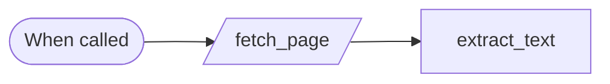

# Newsletter research engine

**Ten sources read, scraped and vetted by a model, every day.**

**The problem.** Finding what is worth putting in a daily newsletter meant reading forums, feeds and blogs by hand before any writing could start.

**What this does about it.** Each source is checked on a schedule, every article is read in full, a model keeps only what is relevant to the audience, and the result is stored as Markdown ready for drafting.

2 workflows, 9 tested behaviours. Import the [reliability kit](../../shared) first: these workflows call it.

> **Built and run in production, rebuilt here on test data.** Node names, order, branches and loops follow the original canvas. What is inside each node was written again for this library, and every name that belonged to the business is a placeholder. The ten source rows were too small to read in the screenshot: three are built as forum feeds and seven as blogs, and where the canvas drops an item with a Filter node inside the loop, this build uses an If node so the loop is handed back.

## Research · Scrape a page

Called with a URL. Fetches the page and returns its readable text and the links in it. A page that fails to load comes back marked as failed instead of stopping the caller.

- **Starts from:** Called by another workflow
- **Platforms:** none, logic only
- **Nodes:** 3
- **Calls:** `error-handler`
- **Files:** [`scrape-page.json`](scrape-page.json) · [`scrape-page.workflow.ts`](scrape-page.workflow.ts)

**How it runs**

1. **Called with a URL.** The page is requested once. A page that errors or times out is an answer, not a crash.
2. **Text and links come back.** Scripts, styles and navigation are removed and what is left is returned as plain text, with the links found in the page.

**Tested behaviour**

- returns the page's text without scripts, styles or navigation
- a page that fails to load comes back marked as failed

## Research · Content aggregation engine

Ten sources are checked on their own schedules: forum feeds and industry blogs. Each new article is scraped in full, judged for relevance to the audience by Gemini, and the ones that pass are saved as Markdown in Google Drive and indexed in Supabase for the newsletter.

- **Starts from:** Schedule
- **Platforms:**  RSS &nbsp;·&nbsp;  Google Drive &nbsp;·&nbsp;  Gemini &nbsp;·&nbsp;  Groq &nbsp;·&nbsp;  Supabase
- **Nodes:** 62
- **Calls:** `scrape-page`, `error-handler`
- **Files:** [`newsletter-research.json`](newsletter-research.json) · [`newsletter-research.workflow.ts`](newsletter-research.workflow.ts)

```mermaid
flowchart LR
  n1sqduxc(["schedule_1"])
  nibz7z4[/"get_feed_1"/]
  n1ml62qk["split_results_1"]
  n1xv6iia["read_feed_1"]
  n5mmg5p["filter_recent_1"]
  n1gmw4pp["data_manipulation_1"]
  n1sqduxd(["schedule_2"])
  nibz7z5[/"get_feed_2"/]
  n1ml62ql["split_results_2"]
  n1xv6iib["read_feed_2"]
  n5mmg5q["filter_recent_2"]
  n1gmw4pq["data_manipulation_2"]
  n1sqduxe(["schedule_3"])
  nibz7z6[/"get_feed_3"/]
  n1ml62qm["split_results_3"]
  n1xv6iic["read_feed_3"]
  n5mmg5r["filter_recent_3"]
  n1gmw4pr["data_manipulation_3"]
  n1sqduxf(["schedule_4"])
  ngjtqn8[/"get_blog_1"/]
  n1ml62qn["split_results_4"]
  n1gmw4ps["data_manipulation_4"]
  n1sqduxg(["schedule_5"])
  ngjtqn9[/"get_blog_2"/]
  n1ml62qo["split_results_5"]
  n1gmw4pt["data_manipulation_5"]
  n1sqduxh(["schedule_6"])
  ngjtqna[/"get_blog_3"/]
  n1ml62qp["split_results_6"]
  n1gmw4pu["data_manipulation_6"]
  n1sqduxi(["schedule_7"])
  ngjtqnb[/"get_blog_4"/]
  n1ml62qq["split_results_7"]
  n1gmw4pv["data_manipulation_7"]
  n1sqduxj(["schedule_8"])
  ngjtqnc[/"get_blog_5"/]
  n1ml62qr["split_results_8"]
  n1gmw4pw["data_manipulation_8"]
  n1sqduxk(["schedule_9"])
  ngjtqnd[/"get_blog_6"/]
  n1ml62qs["split_results_9"]
  n1gmw4px["data_manipulation_9"]
  nhus3fk(["schedule_10"])
  ngjtqne[/"get_blog_7"/]
  n14gezis["split_results_10"]
  n1x16upf["data_manipulation_10"]
  nr95kuv["set_item"]
  n4ax3i0["for_each_content"]
  n1v1i2w7["get_files"]
  njru04{"skip_existing"}
  nli1lpn["set_url"]
  nfk41ij[["scrape_url"]]
  nwpouhi{"filter_scrape_errors"}
  n1fb6ziv[["validate_content"]]
  n1hk4mq4("Google Gemini Chat Model")
  n1350pkc("content_parser")
  n1mkyatp("Groq Chat Model")
  n1tb5kmu("Structured Output Parser")
  n9w5rx9{"filter_relevant"}
  n158fgi8["format_markdown"]
  nwjsiab["upload_file"]
  n173zj8y["create_object_info"]
  n1sqduxc --> nibz7z4
  nibz7z4 --> n1ml62qk
  n1ml62qk --> n1xv6iia
  n1xv6iia --> n5mmg5p
  n5mmg5p --> n1gmw4pp
  n1gmw4pp --> nr95kuv
  n1sqduxd --> nibz7z5
  nibz7z5 --> n1ml62ql
  n1ml62ql --> n1xv6iib
  n1xv6iib --> n5mmg5q
  n5mmg5q --> n1gmw4pq
  n1gmw4pq --> nr95kuv
  n1sqduxe --> nibz7z6
  nibz7z6 --> n1ml62qm
  n1ml62qm --> n1xv6iic
  n1xv6iic --> n5mmg5r
  n5mmg5r --> n1gmw4pr
  n1gmw4pr --> nr95kuv
  n1sqduxf --> ngjtqn8
  ngjtqn8 --> n1ml62qn
  n1ml62qn --> n1gmw4ps
  n1gmw4ps --> nr95kuv
  n1sqduxg --> ngjtqn9
  ngjtqn9 --> n1ml62qo
  n1ml62qo --> n1gmw4pt
  n1gmw4pt --> nr95kuv
  n1sqduxh --> ngjtqna
  ngjtqna --> n1ml62qp
  n1ml62qp --> n1gmw4pu
  n1gmw4pu --> nr95kuv
  n1sqduxi --> ngjtqnb
  ngjtqnb --> n1ml62qq
  n1ml62qq --> n1gmw4pv
  n1gmw4pv --> nr95kuv
  n1sqduxj --> ngjtqnc
  ngjtqnc --> n1ml62qr
  n1ml62qr --> n1gmw4pw
  n1gmw4pw --> nr95kuv
  n1sqduxk --> ngjtqnd
  ngjtqnd --> n1ml62qs
  n1ml62qs --> n1gmw4px
  n1gmw4px --> nr95kuv
  nhus3fk --> ngjtqne
  ngjtqne --> n14gezis
  n14gezis --> n1x16upf
  n1x16upf --> nr95kuv
  nr95kuv --> n4ax3i0
  n4ax3i0 -->|each| n1v1i2w7
  n1v1i2w7 --> njru04
  njru04 --> nli1lpn
  nli1lpn --> nfk41ij
  nfk41ij --> nwpouhi
  nwpouhi --> n1fb6ziv
  n1fb6ziv --> n9w5rx9
  n9w5rx9 --> n158fgi8
  n158fgi8 --> nwjsiab
  nwjsiab --> n173zj8y
  n173zj8y --> n4ax3i0
  njru04 --> n4ax3i0
  nwpouhi --> n4ax3i0
  n9w5rx9 --> n4ax3i0
  n1hk4mq4 -.-> n1fb6ziv
  n1350pkc -.-> n1fb6ziv
  n1mkyatp -.-> n1350pkc
  n1tb5kmu -.-> n1350pkc
```

**How it runs**

1. **Ten sources, ten schedules.** Each source has its own trigger a few minutes apart, so one slow site never holds up the others.
2. **Forum feeds.** For the three forums, an index of threads is fetched, each thread is read as RSS, and only items from the last day are kept.
3. **Industry blogs.** For the seven blogs, the listing of recent posts is fetched and split into single articles.
4. **One shape for every source.** Whatever the source, an article becomes the same record: address, title, source, date and a file-safe name.
5. **Already stored?.** Articles are taken one at a time. Google Drive is searched for the article's file name, and one that is already there is skipped.
6. **The full article is fetched.** A headline is not enough to judge by. The page is scraped for its full text and the links it cites.
7. **Did the page load?.** A page that failed, or came back with too little text to be an article, is dropped and the loop moves on.
8. **A model judges relevance.** Gemini reads the article and says whether it belongs in the newsletter, with a topic and a short summary. If its answer is not in the required shape, a second model on Groq repairs it.
9. **Only relevant articles go on.** An article judged off-topic is dropped. If the model is down, the article is dropped too: nothing is stored on a guess.
10. **Saved for the newsletter.** The article becomes a Markdown file in Google Drive, and a row in Supabase records its date, topic, summary, links and where the file is.

**Tested behaviour**

- a relevant article is scraped, saved to Drive and indexed
- an off-topic article is dropped and the next one still runs
- an article already in the store is not scraped again
- a page that fails to load is skipped and the next one still runs
- nothing is stored when the model is down
- an answer in the wrong shape is repaired by the second model
- a forum feed keeps only the last day's items
