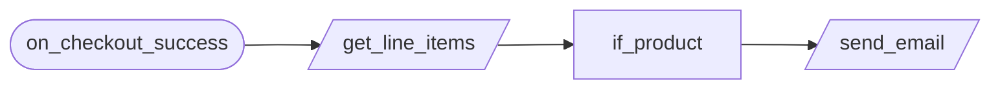
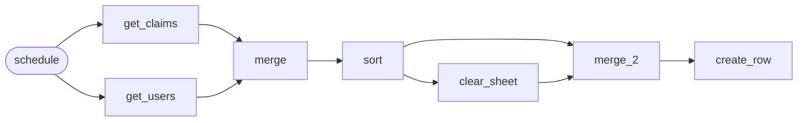
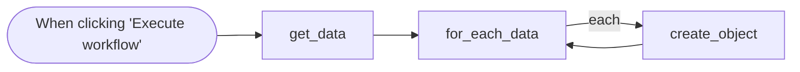
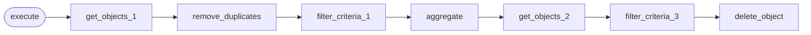

# Production · Operations

5 workflows. Each one is tested against a real n8n; the cases are listed under it.

> **Built and run in production, rebuilt here on test data.** Node names, order, branches and loops follow the original canvas. What is inside each node was written again for this library, and every name that belonged to the business is a placeholder. The node the bulk creator read its rows from could not be identified in the screenshot; here they come from a Google Sheet.

## Events · Unified event API

One web address that returns every active event. It signs in to the self-hosted event platform, reads its events, adds the Luma events kept in a Google Sheet, drops the past and inactive ones, and answers with one list in one format.

- **Starts from:** Webhook
- **Platforms:**  Google Sheets
- **Nodes:** 9
- **Calls:** `error-handler`
- **Files:** [`unified-event-api.json`](unified-event-api.json) · [`unified-event-api.workflow.ts`](unified-event-api.workflow.ts)

```mermaid
flowchart LR
  nybva67(["get_request"])
  no2gbj8[/"platform_login"/]
  ni4abmx[/"get_events"/]
  n1uffvst["get_external_events"]
  nr9206m["set_data"]
  n1ygu2nq["split_data"]
  ntshcx0["check_active"]
  n1yzfv["data_manipulation"]
  n6te94e(["respond"])
  nybva67 --> no2gbj8
  no2gbj8 --> ni4abmx
  ni4abmx --> n1uffvst
  n1uffvst --> nr9206m
  nr9206m --> n1ygu2nq
  n1ygu2nq --> ntshcx0
  ntshcx0 --> n1yzfv
  n1yzfv --> n6te94e
```

**How it runs**

1. **A request comes in.** The workflow signs in to the event platform with its own account and keeps the session token for the next call.
2. **Two sources are read.** The platform's own events come from its API. The Luma events are read from the Google Sheet they are kept in.
3. **One list goes back.** Both sets are put in one shape and split into single events. Past and inactive ones are dropped, and what is left is the answer. No active events is an empty list, not an error.

**Tested behaviour**

- answers with platform and Luma events in one list
- leaves out past and inactive events
- answers with an empty list when nothing is active
- sends the session token it was given

## Payments · Post-purchase email

When a Stripe checkout completes, reads the line items, checks which product was bought, and sends that product's email through SendGrid. A purchase of anything else sends nothing.

- **Starts from:** Stripe event
- **Platforms:**  Stripe &nbsp;·&nbsp;  SendGrid
- **Nodes:** 4
- **Calls:** `error-handler`
- **Files:** [`post-purchase-email.json`](post-purchase-email.json) · [`post-purchase-email.workflow.ts`](post-purchase-email.workflow.ts)

**How it runs**

1. **A checkout completes.** Stripe sends the event. The event does not say what was bought, so the line items are fetched from Stripe.
2. **Only the right product.** The line items are checked for the product this email belongs to. Anything else stops here.
3. **The email goes out.** SendGrid sends the product's template to the buyer's address. The call retries if SendGrid is briefly down.

**Tested behaviour**

- sends the product's email to the buyer
- a different product sends nothing
- retries when SendGrid is briefly down

## Data · Cross-team data sync

On a schedule, reads claims and users from the Bubble app's database, joins and sorts them, then clears a shared Google Sheet and refills it, so people without database access always see current data.

- **Starts from:** Schedule
- **Platforms:**  Bubble &nbsp;·&nbsp;  Google Sheets
- **Nodes:** 8
- **Calls:** `error-handler`
- **Files:** [`cross-team-data-sync.json`](cross-team-data-sync.json) · [`cross-team-data-sync.workflow.ts`](cross-team-data-sync.workflow.ts)

**How it runs**

1. **Two tables are read.** On each run the claims and the users are read from the Bubble database.
2. **Joined and sorted.** Each claim is matched to its user, and the result is sorted newest first.
3. **The sheet is replaced.** The old rows are cleared, and only once that has finished are the new rows written. If the database returns nothing, the sheet is left as it was.

**Tested behaviour**

- clears the sheet, then writes each claim with its user
- sorts the newest claim first
- an empty database leaves the sheet alone

## Data · Bulk object creator

One click reads every row of a sheet and creates an object in the Bubble database for each, one at a time.

- **Starts from:** Manual run
- **Platforms:**  Google Sheets &nbsp;·&nbsp;  Bubble
- **Nodes:** 4
- **Calls:** `error-handler`
- **Files:** [`bulk-object-creator.json`](bulk-object-creator.json) · [`bulk-object-creator.workflow.ts`](bulk-object-creator.workflow.ts)

**How it runs**

1. **One click.** The rows to import are read from the sheet.
2. **One object per row.** Each row becomes an object in Bubble, with its columns mapped to the object's fields. A row at a time keeps the app's rate limit safe.

**Tested behaviour**

- creates one object per row
- an empty sheet creates nothing

## Data · Database cleansing

On demand, reads every object of one type from the Bubble database, keeps the first of each set of duplicates as the master, and deletes the rest.

- **Starts from:** Manual run
- **Platforms:**  Bubble
- **Nodes:** 8
- **Calls:** `error-handler`
- **Files:** [`database-cleansing.json`](database-cleansing.json) · [`database-cleansing.workflow.ts`](database-cleansing.workflow.ts)

**How it runs**

1. **Find the masters.** Every object that has an email is read, and the first one for each email is kept as the master. Objects with no email are never asked for: they cannot be called duplicates of anything.
2. **Isolate the duplicates.** The objects are read again and compared with the list of masters. Only an object that has an email and is not a master goes forward.
3. **Delete them.** Each duplicate is deleted by its id. With no duplicates, nothing is deleted.

**Tested behaviour**

- deletes the duplicates and keeps the first of each
- deletes nothing when there are no duplicates
- never deletes an object that has no email
