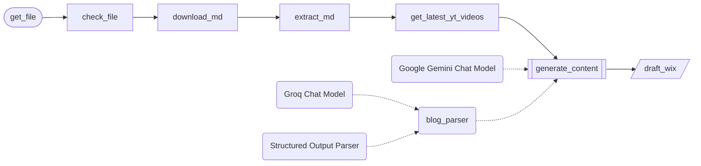

# Production · Publishing

1 workflows. Each one is tested against a real n8n; the cases are listed under it.

> **Built and run in production, rebuilt here on test data.** Node names, order, branches and loops follow the original canvas. What is inside each node was written again for this library, and every name that belonged to the business is a placeholder.

## Publishing · Markdown to blog draft

A Markdown file sent to a Telegram bot is turned into a blog post. Gemini restructures the notes, picks a recent YouTube video fetched through Apify to embed, and works in the promotion of the week. The post is saved to Wix as a draft for an editor to review.

- **Starts from:** Telegram event
- **Platforms:**  Telegram &nbsp;·&nbsp;  Apify &nbsp;·&nbsp;  Gemini &nbsp;·&nbsp;  Groq &nbsp;·&nbsp;  Wix
- **Nodes:** 11
- **Calls:** `error-handler`
- **Files:** [`blog-conversion.json`](blog-conversion.json) · [`blog-conversion.workflow.ts`](blog-conversion.workflow.ts)

**How it runs**

1. **A file is sent to the bot.** An editor sends a Markdown file to the Telegram bot. Anything that is not a Markdown file is ignored.
2. **The text is read.** The file is downloaded from Telegram and its text extracted.
3. **Recent videos are fetched.** An Apify task returns the channel's latest YouTube videos, so the post can embed one that fits.
4. **The post is written.** Gemini restructures the notes into a title, an excerpt and a body, chooses a video and works the promotion in. If its answer is not in the required shape, a second model on Groq repairs it.
5. **Saved as a draft.** The post goes to Wix as a draft. Nothing is published until an editor has read it.

**Tested behaviour**

- turns an uploaded Markdown file into a Wix draft with a video
- ignores a file that is not Markdown
- a reply in the wrong shape is repaired by the second model
- still drafts the post when no videos come back
