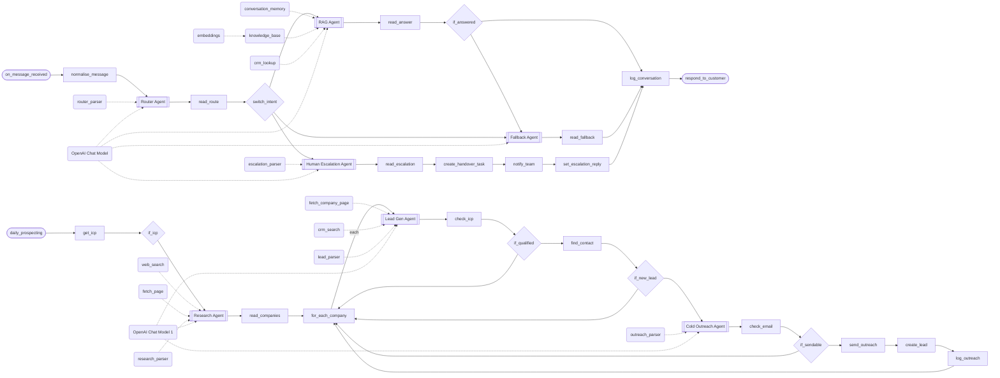

# Revenue and support agent pipeline

**Six agents: three answer the inbox, three run outbound.**

**The problem.** First-line support and top-of-funnel prospecting are both repetitive, and both stop when the people doing them are busy.

**What this does about it.** Inbound messages are routed, answered from the knowledge base and CRM or handed to a person with a brief. Outbound, agents find companies and people who fit the customer profile and write to them, with the profile and the email checked in code.

One canvas of 49 nodes, 10 tested behaviours. Import the [reliability kit](../../shared) first: these workflows call it.

> **Built and run in production, rebuilt here on test data.** Node names, order, branches and loops follow the original canvas. What is inside each node was written again for this library, and every name that belonged to the business is a placeholder. The two tracks and six agents are the original's. The canvas was too small to read node by node, so the steps between the agents follow the written description; sending through Gmail and alerting in Slack are this build's choices.

## AI agents · Revenue and support pipeline

Two tracks on one canvas. Inbound messages go to a router agent, which hands each one to a RAG agent that answers from the Supabase knowledge base and HubSpot, to a fallback agent, or to a human escalation agent that briefs a person. On weekdays, research and lead gen agents find people who fit the ideal customer profile, and a cold outreach agent writes to them and files them in the CRM.

- **Starts from:** Webhook, Schedule
- **Platforms:**  Supabase &nbsp;·&nbsp;  OpenAI &nbsp;·&nbsp;  HubSpot &nbsp;·&nbsp;  Slack &nbsp;·&nbsp;  SerpAPI &nbsp;·&nbsp;  Gmail
- **Nodes:** 49
- **Calls:** `error-handler`
- **Files:** [`revenue-support-agents.json`](revenue-support-agents.json) · [`revenue-support-agents.workflow.ts`](revenue-support-agents.workflow.ts)

**How it runs**

1. **A message arrives.** The webhook takes the message and puts it in one shape: who it is from, which conversation it belongs to and what it says.
2. **The router agent reads it.** It names the intent and how sure it is. It does not answer.
3. **Code decides the route.** A clear support or sales question goes to be answered. A low-confidence reading goes to the fallback agent. Anything that mentions a refund, a complaint, legal action or asks for a person goes to a human, whatever the model thought.
4. **The RAG agent answers from what is known.** It searches the knowledge base held in Supabase, can look the customer up in HubSpot, and remembers the conversation so far. It is told to say so when the tools do not hold the answer.
5. **No answer, no guess.** If the RAG agent could not answer, the message goes to the fallback agent, which asks the one question that would make it answerable or says the team will follow up. If that model is down too, a fixed reply is sent.
6. **A person is briefed.** The human escalation agent writes a summary for the colleague who picks the conversation up, rates its urgency and writes a holding reply. A task is created in HubSpot and the team is told in Slack.
7. **Logged and answered.** Every conversation is stored in Supabase with who handled it, and the reply goes back to the customer.
8. **Outbound starts from the profile.** On weekdays the ideal customer profile is read from Supabase: industry, size, region, the role to reach and what is on offer. With no active profile, nothing runs.
9. **The research agent finds companies.** It searches the web and fetches each company's own site to confirm the fit before listing it. The list is deduplicated and capped in code.
10. **The lead gen agent finds the person.** For each company it reads the team and contact pages for the person in the right role, and can check the CRM.
11. **The profile is applied in code.** A lead qualifies only with a named person, an email at the company's own domain, evidence for the role and a fit score of 70 or more. Someone already in HubSpot is not contacted again.
12. **The cold outreach agent writes.** One short email built on what was found about the company. Code checks its length and that no placeholder was left in before it can be sent.
13. **Sent, filed and logged.** The email goes out through Gmail, the lead is created in HubSpot, and the send is logged in Supabase.

**Tested behaviour**

- a support question is answered from the knowledge base
- what the knowledge base cannot answer goes to the fallback agent
- an unclear message skips the RAG agent
- a complaint reaches a person even when the router calls it support
- the customer still gets a reply when every model is down
- a qualified lead is emailed, created in HubSpot and logged
- a lead that fails the profile is not contacted, whatever the model scored
- someone already in HubSpot is not emailed again
- an email with a placeholder left in is not sent
- nothing runs without an active customer profile
