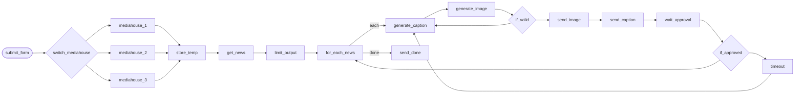
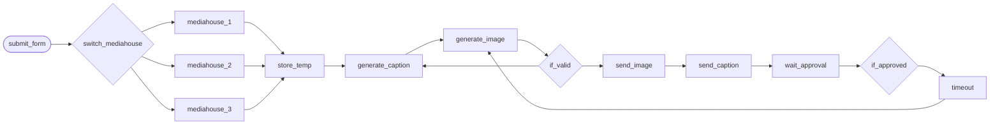
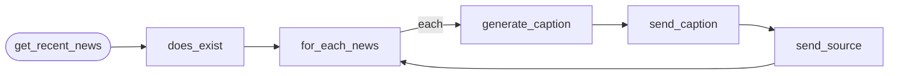

# Production · Social-content

3 workflows. Each one is tested against a real n8n; the cases are listed under it.

> **Built and run in production, rebuilt here on test data.** Node names, order, branches and loops follow the original canvas. What is inside each node was written again for this library, and every name that belonged to the business is a placeholder.

## Social · News to social content engine

A form request picks a media brand. The workflow applies that brand's voice, reads its news feed, and for each article drafts a caption and an image with Gemini, checks its own output, and sends the draft to the social manager on Telegram. Approved moves to the next article; rejected is drafted again.

- **Starts from:** Form
- **Platforms:**  RSS &nbsp;·&nbsp;  Gemini &nbsp;·&nbsp;  Telegram
- **Nodes:** 18
- **Calls:** `error-handler`
- **Files:** [`social-content-engine.json`](social-content-engine.json) · [`social-content-engine.workflow.ts`](social-content-engine.workflow.ts)

**How it runs**

1. **A request names the brand.** The form asks which media house the posts are for and how many. The switch sends the request to that brand's profile: its voice, its visual style, its hashtags and its feed.
2. **The news is fetched.** The brand's feed is read and cut to the number of posts asked for.
3. **One article at a time.** Each article gets a caption in the brand's voice and an image in its style, both from Gemini.
4. **It checks its own work.** An empty caption, one that is too long, a refusal or a missing image never reaches a person. The draft is made again.
5. **A person decides.** The image and the caption arrive on Telegram with Approve and Decline. The run waits for the answer.
6. **Approved moves on, rejected is redone.** Approval moves to the next article. A rejection goes back to Gemini for a new draft of the same article. An unanswered request ends the run instead of looping.

**Tested behaviour**

- drafts each article and moves on when approved
- a rejected draft is made again for the same article
- an empty caption is redone before anyone sees it
- each brand reads its own feed with its own voice

## Social · On-demand post generator

A form takes a topic, a prompt or a link and a media brand. The workflow applies the brand's voice, keeps the link as the post's source, drafts a caption and an image with Gemini, checks them, and sends them to Telegram for approval. A rejection produces a new image.

- **Starts from:** Form
- **Platforms:**  Gemini &nbsp;·&nbsp;  Telegram
- **Nodes:** 14
- **Calls:** `error-handler`
- **Files:** [`social-post-on-demand.json`](social-post-on-demand.json) · [`social-post-on-demand.workflow.ts`](social-post-on-demand.workflow.ts)

**How it runs**

1. **A topic, a prompt or a link.** The form takes the request and the media house. The switch applies that brand's voice and visual style.
2. **A link is kept as the source.** If the request holds a link, it is pulled out, the post is marked as an article, and the link goes into the caption.
3. **Caption and image.** Gemini drafts the caption and a matching image, and the workflow checks both before going further.
4. **A person decides.** The draft goes to the social manager on Telegram. Approval ends the run with the post ready. A rejection produces a new image for the same caption.

**Tested behaviour**

- drafts a post from a topic and stops when approved
- a link becomes the post's source and goes into the caption
- a rejection draws a new image for the same caption
- a refusal from the model is redone before anyone sees it

## Social · RSS to caption

Watches an RSS feed. Each new article is turned into a summary-style caption by Gemini and sent to the social manager's Telegram, followed by the source link, ready to copy and post.

- **Starts from:** RSS event
- **Platforms:**  RSS &nbsp;·&nbsp;  Gemini &nbsp;·&nbsp;  Telegram
- **Nodes:** 6
- **Calls:** `error-handler`
- **Files:** [`rss-to-caption.json`](rss-to-caption.json) · [`rss-to-caption.workflow.ts`](rss-to-caption.workflow.ts)

**How it runs**

1. **The feed is watched.** The trigger fires only for items it has not seen. An item with no link or no text is dropped.
2. **A caption per article.** Each article goes to Gemini, which writes a short summary-style caption.
3. **Delivered to Telegram.** The caption arrives first and the source link straight after it, as two messages, so each can be copied on its own.

**Tested behaviour**

- sends a caption, then the source link, for each new article
- an item with no link is dropped
- an empty reply from the model sends the headline instead
