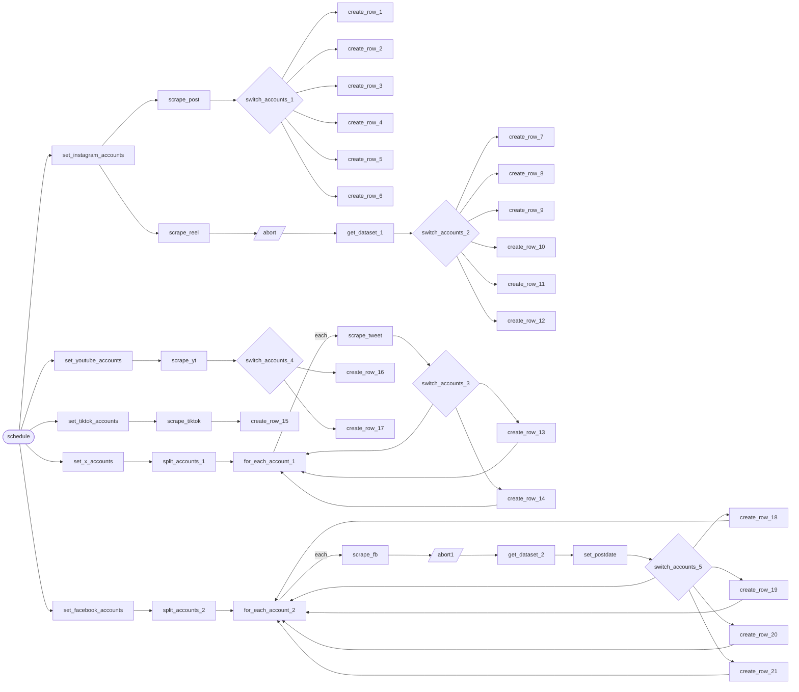

# Social intelligence scraper

**Five networks scraped each morning into the sheets a dashboard reads.**

**The problem.** Tracking how the brand's and its competitors' posts perform meant opening five networks and copying numbers by hand.

**What this does about it.** Apify tasks collect the posts for every tracked account, each post is routed by account, and every record lands in one format in a Google Sheet that Tableau reads.

One canvas of 47 nodes, 6 tested behaviours. Import the [reliability kit](../../shared) first: these workflows call it.

> **Built and run in production, rebuilt here on test data.** Node names, order, branches and loops follow the original canvas. What is inside each node was written again for this library, and every name that belonged to the business is a placeholder.

## Social intelligence · Omnichannel scraper

Every morning, Apify tasks collect posts from Instagram (posts and reels), X, TikTok, YouTube and Facebook for the brand's own accounts and its competitors'. Each post is routed by account and written to that account's Google Sheet, which is the source a Tableau dashboard reads.

- **Starts from:** Schedule
- **Platforms:**  Apify &nbsp;·&nbsp;  Google Sheets
- **Nodes:** 47
- **Calls:** `error-handler`
- **Files:** [`social-intelligence-scraper.json`](social-intelligence-scraper.json) · [`social-intelligence-scraper.workflow.ts`](social-intelligence-scraper.workflow.ts)

**How it runs**

1. **One schedule, five networks.** Each morning the schedule starts a track for Instagram, X, TikTok, YouTube and Facebook at the same time. Each track starts from its own list of accounts.
2. **Instagram posts.** A saved Apify task scrapes the latest posts for all six accounts and hands back its dataset.
3. **Sorted by account.** A switch sends each post to the branch for the account it belongs to. A post from an account that is not on the list goes nowhere.
4. **Written to that account's sheet.** Each account has its own spreadsheet. A post already in the sheet is updated with today's numbers instead of being added twice.
5. **Instagram reels.** Reels run as a separate task with a time limit. The run is stopped through Apify's API, then whatever it collected is read and sorted the same way.
6. **X, one account at a time.** The X accounts are looped over. An account with nothing new hands the loop straight back so the next one still runs.
7. **TikTok and YouTube.** TikTok covers the brand's own account. YouTube covers the brand and one competitor, split by channel.
8. **Facebook, one page at a time.** Each page is scraped in turn. The post date is put in one format before the row is written, so the dashboard can chart every network on the same axis.

**Tested behaviour**

- writes each Instagram post to the sheet of the account it belongs to
- a post from an account that is not tracked is not written
- stops the reels run, then reads what it collected
- every X account is scraped even when one has nothing new
- writes tweets, TikTok and YouTube videos with one set of columns
- Facebook pages are scraped one at a time and the post date is normalised
