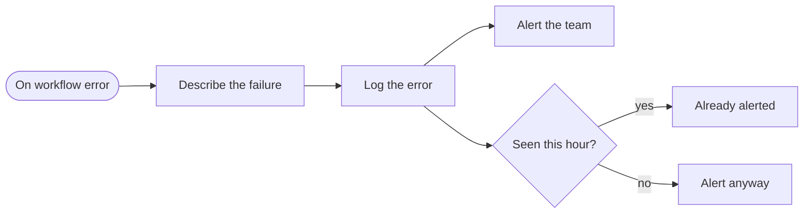
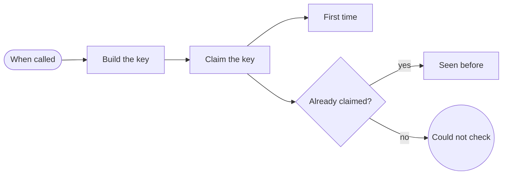
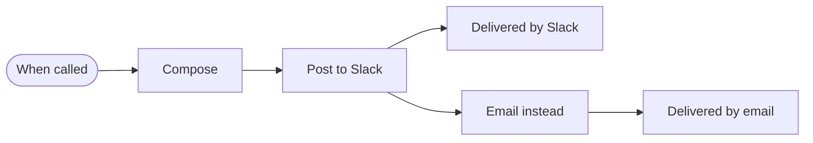
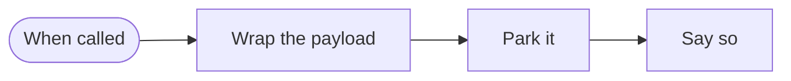
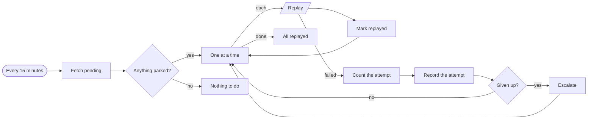
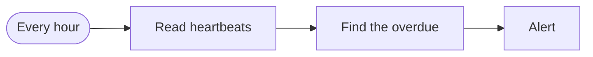

# Reliability kit

**What every other workflow leans on when something fails.**

**The problem.** Automations fail silently: a webhook arrives twice, an API is down, a schedule stops.

**What this does about it.** Failures are caught, alerted once, parked for replay and noticed even when the failure is that nothing ran.

6 workflows, 16 tested behaviours. Import the [reliability kit](../../shared) first: these workflows call it.

## Reliability · Error handler

Catches a failure in any workflow, logs it to Supabase, and alerts Slack once per distinct error per hour so a broken loop cannot flood the channel.

- **Starts from:** A failure in any workflow
- **Platforms:**  Supabase &nbsp;·&nbsp;  Slack
- **Nodes:** 7
- **Calls:** nothing
- **Files:** [`error-handler.json`](error-handler.json) · [`error-handler.workflow.ts`](error-handler.workflow.ts)

**How it runs**

1. **A workflow fails.** Every workflow in the library names this one as its error workflow, so a failure anywhere arrives here.
2. **It is logged once.** The error is written to Supabase with a fingerprint of workflow, node, message and hour. A unique constraint refuses a repeat inside the hour.
3. **Slack hears about it once.** Only a new fingerprint posts an alert, so a loop failing a thousand times is one message. If the log itself is down, the alert still goes.

**Tested behaviour**

- a new failure is logged and alerted
- the same failure inside the hour is not alerted twice
- an alert still goes when the log is down

## Reliability · Idempotency guard

Answers one question for a caller: has this event been handled before? Webhooks are delivered more than once; a unique key in Supabase is what makes that safe.

- **Starts from:** Called by another workflow
- **Platforms:**  Supabase
- **Nodes:** 7
- **Calls:** `error-handler`
- **Files:** [`idempotency-guard.json`](idempotency-guard.json) · [`idempotency-guard.workflow.ts`](idempotency-guard.workflow.ts)

**How it runs**

1. **A caller asks.** It passes a scope and a key: an order id, a payment event id, a lead's email.
2. **The key is claimed in Supabase.** One insert against a unique constraint. The database decides, so two runs at the same moment cannot both win.
3. **A refused insert is read carefully.** Refused because the key exists means duplicate. Refused for any other reason stops the caller: an outage is never mistaken for 'already handled'.

**Tested behaviour**

- a first event is not a duplicate
- a repeat is a duplicate
- a database outage stops the caller and is not read as a duplicate

## Reliability · Notify

The one place alerts leave from. Posts to Slack, and falls back to a SendGrid email when Slack is down, so an outage cannot hide its own alert.

- **Starts from:** Called by another workflow
- **Platforms:**  Slack &nbsp;·&nbsp;  SendGrid
- **Nodes:** 6
- **Calls:** `error-handler`
- **Files:** [`notify.json`](notify.json) · [`notify.workflow.ts`](notify.workflow.ts)

**How it runs**

1. **Something needs saying.** Any workflow calls this with a text and a level. No other workflow talks to Slack for alerts.
2. **Slack first.** Three attempts, a second apart.
3. **SendGrid if Slack is down.** A failure after the retries takes the second output and the alert still arrives, by email.

**Tested behaviour**

- posts to Slack
- falls back to email when Slack stays down
- recovers when Slack fails once

## Reliability · Dead letter

Keeps the payload of work that could not be finished in Supabase, with the reason, so nothing is lost when a platform is down.

- **Starts from:** Called by another workflow
- **Platforms:**  Supabase &nbsp;·&nbsp;  Slack
- **Nodes:** 4
- **Calls:** `error-handler`
- **Files:** [`dead-letter.json`](dead-letter.json) · [`dead-letter.workflow.ts`](dead-letter.workflow.ts)

**How it runs**

1. **Work could not be finished.** A caller hands over the payload, where it came from and why it failed.
2. **It is parked, not dropped.** The payload is stored in Supabase as pending, with the address that can replay it.
3. **Slack is told.** The alert is best effort: parking has already succeeded.

**Tested behaviour**

- parks the payload as pending
- still parks when Slack cannot be reached

## Reliability · Dead letter replay

Every fifteen minutes, sends parked work back to where it came from. Gives up after five attempts and tells Slack.

- **Starts from:** Schedule
- **Platforms:**  Supabase &nbsp;·&nbsp;  Slack
- **Nodes:** 12
- **Calls:** `error-handler`
- **Files:** [`dead-letter-replay.json`](dead-letter-replay.json) · [`dead-letter-replay.workflow.ts`](dead-letter-replay.workflow.ts)

**How it runs**

1. **On a timer.** Every fifteen minutes it asks Supabase for parked work.
2. **One at a time.** Each item is sent back to the address that can redo it. One slow item does not hold the others.
3. **Five attempts, then a person.** A failed replay is counted. At five the item is abandoned and escalated in Slack.

**Tested behaviour**

- replays pending items and marks them
- abandons after the fifth failure and escalates
- does nothing when nothing is parked

## Reliability · Heartbeat monitor

Notices the failure nobody reports: a scheduled workflow that silently stopped running. Each one checks in to Supabase, and this alerts Slack when a check-in is overdue.

- **Starts from:** Schedule
- **Platforms:**  Supabase &nbsp;·&nbsp;  Slack
- **Nodes:** 4
- **Calls:** `error-handler`
- **Files:** [`heartbeat-monitor.json`](heartbeat-monitor.json) · [`heartbeat-monitor.workflow.ts`](heartbeat-monitor.workflow.ts)

**How it runs**

1. **Workflows check in.** Each scheduled workflow writes a timestamp to Supabase when it finishes.
2. **Silence is measured.** A check-in older than the workflow's own allowed gap is overdue.
3. **One Slack alert per silent workflow.** Nothing overdue means nothing is sent.

**Tested behaviour**

- alerts for a workflow that went quiet
- stays quiet when everything checked in
