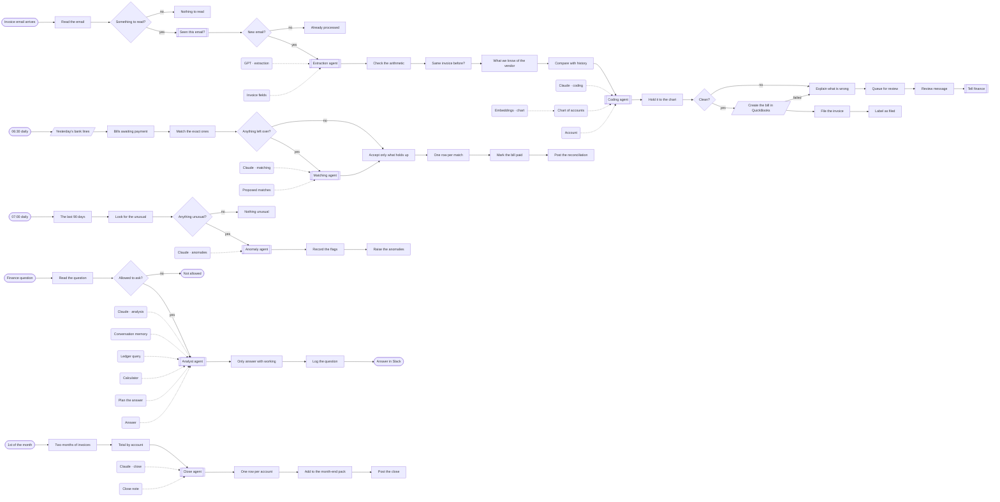

# AI back office

**Invoices, receipts and bank lines, read, matched and questioned.**

**The problem.** Bookkeeping is typing what a document already says, then finding the one line that does not match.

**What this does about it.** Documents are read by a model and checked by arithmetic, bank lines are matched, anomalies are raised, and finance can ask questions in Slack and get answers from the books.

1 workflows, 13 tested behaviours. Import the [reliability kit](../../shared) first: these workflows call it.

## AI back office · Invoices, bank lines and questions

Agents read supplier invoices from Gmail, code them against the chart of accounts and file them in QuickBooks. Bank lines are matched every morning, the ledger is scanned for anomalies, finance can ask questions in Slack, and the month closes into a Google Sheets pack. Every figure is checked or computed in code.

| | |
|---|---|
| Starts from | undefined |
| Platforms | Gmail, OpenAI, Supabase, Claude, Pinecone, QuickBooks, Slack, Google Sheets |
| Nodes | 72 |
| Calls | `idempotency-guard`, `notify`, `error-handler` |
| Files | [`ai-back-office.json`](ai-back-office.json) · [`ai-back-office.workflow.ts`](ai-back-office.workflow.ts) |

**How it runs**

1. **An invoice arrives by email.** Gmail brings it in. An email with nothing to read, or one already processed, stops here.
2. **A model copies the fields.** Vendor, number, dates, lines, totals and the bank account to pay. It is told to copy, never to work a number out.
3. **Code checks the document against itself.** Do the lines add up to the subtotal? Is subtotal plus tax the total? Is it due after it was issued? A model's reading that fails its own arithmetic goes no further.
4. **And against what is already known.** The same invoice number twice, a new vendor, three times the usual amount, or a bank account that differs from the one on file. That last one is how invoice fraud works, and it is marked critical.
5. **A coding agent picks the account.** It searches the chart of accounts in Pinecone. Code accepts its answer only if the account exists in the chart.
6. **Clean invoices become bills.** The bill is created in QuickBooks, filed in Supabase and the email is labelled.
7. **Anything else goes to a person, with the reason.** Finance gets every problem found, in one message, so the check takes seconds.
8. **Each morning, bank lines meet bills.** The same amount with the invoice number in the memo is matched in code.
9. **An agent proposes the awkward ones.** A vendor name in the memo, a reference that is nearly right. The proposal is accepted only if the amounts are equal and the agent is confident.
10. **The ledger is scanned for the unusual.** Three rules in code: far from a vendor's usual amount, the same amount twice in a week, a round sum from a new vendor. The agent orders and explains the flags; it cannot add one.
11. **Finance asks a question in Slack.** Only named people may ask. The analyst agent can read the ledger and use a calculator. It has no tool that pays, changes or deletes.
12. **No working, no answer.** A reply with no ledger rows behind it is replaced by 'I could not answer that'. Every question is logged.
13. **The first of the month.** Spend by account against the month before is totalled in code, added to the Google Sheets pack, and an agent writes the note that goes with it.

**Tested behaviour**

- a clean invoice is read, checked, coded and filed as a QuickBooks bill
- an invoice whose own numbers do not add up never reaches QuickBooks
- a known vendor with a new bank account is stopped and marked critical
- an invoice number this vendor already sent is not filed twice
- an account that is not in the chart is refused
- the same email delivered twice is processed once
- bank lines are matched exactly in code, and an agent's proposal needs equal amounts
- an invoice ten times a vendor's usual amount is flagged by rule and explained
- an ordinary day raises nothing and calls no model
- a finance question is answered from the ledger, with its working
- someone outside finance is refused before any model is called
- an answer with no ledger rows behind it is not given
- month end totals each account against the month before and fills the pack
