# AI content studio

**Research to published article, voice-over and social posts.**

**The problem.** Publishing well takes research, writing, fact-checking, optimising, recording and sharing, and one of them always slips.

**What this does about it.** Agents research, write, fact-check and optimise each piece. A person approves it, then it is published, voiced and shared, and its results come back as next week's brief.

1 workflows, 13 tested behaviours. Import the [reliability kit](../../shared) first: these workflows call it.

## AI content studio · Research to published, voiced and shared

Seven agents take a topic from research to a fact-checked, optimised draft. A person approves it in Slack, then it is published to WordPress with a cover image and an ElevenLabs voice-over, shared to LinkedIn, X and Facebook, and its results in PostHog become next week's topics.

| | |
|---|---|
| Starts from | Schedule |
| Platforms | Supabase, SerpAPI, Claude, Pinecone, OpenAI, Slack, WordPress, ElevenLabs, LinkedIn, X, Facebook, PostHog |
| Nodes | 84 |
| Calls | `notify`, `error-handler` |
| Files | [`ai-content-studio.json`](ai-content-studio.json) · [`ai-content-studio.workflow.ts`](ai-content-studio.workflow.ts) |

```mermaid
flowchart LR
  njkudyd(["Weekdays 07:00"])
  n1s0dx61["Next topic"]
  neeo9iy{"Is there a topic?"}
  n11tw0rx["Queue is empty"]
  n1twx045["Claim the topic"]
  nh6kunc{"Claimed it?"}
  n8pfd56["Another run has it"]
  n5loay7[/"Search the topic"/]
  n9uevm4["Collect the sources"]
  n1ab2rko{"Enough to write from?"}
  n15uf5lz[["Research agent"]]
  n1m4fsrj("Claude · research")
  n7honol("Reason it through")
  n161pw4j("Research notes")
  nshxvq0["Keep the supported points"]
  nqnttcw[["Outline agent"]]
  n1gi8d1a("Claude · outline")
  nw34bes("Past articles")
  n12l25h("Embeddings · past articles")
  n1wxltmj("Outline")
  nzzdkc4["Check the outline"]
  n11h8q5a{"Usable outline?"}
  n16ajjcv[["Writer agent"]]
  nqa5120("Claude · writing")
  n12orwoa("House style")
  nf7n4gb("Embeddings · style")
  n19laxus["Read the article"]
  n12hzinn[["Fact-check agent"]]
  n1p5pvjg("GPT · fact-check")
  n1t4ukda("Claims")
  n1pbbc7l["Weigh the claims"]
  np0zx8h{"Every claim supported?"}
  ninx2iz{"Worth a rewrite?"}
  n1wvg08p[["Editor agent"]]
  n13ktff8("Claude · editing")
  n19xup3f["Recheck the edit"]
  nn1yv47{"Clean now?"}
  nlxsxff[["SEO agent"]]
  n1q1vujc("GPT · SEO")
  n59vvw("Meta")
  n1n6n37w["Enforce the limits"]
  nqrrbjq["Save the draft"]
  nk0wy08["Ask for approval"]
  nm3o02u["Could not finish"]
  n1dhughj["Return the topic"]
  nc24wrh["Returned message"]
  nwr211g[["Tell the editor"]]
  ne9uvpf(["Decision"])
  nmemhf2["Read the decision"]
  n2xqlyi{"Valid?"}
  nmff94d(["Bad request"])
  n1by9xkn["Take it if pending"]
  n1n0t10v{"Awaiting approval?"}
  n1012if7(["Not pending"])
  n1dst0kh{"Approved?"}
  n1tvvf6t(["Rejected"])
  n1xs7vmi(["Publishing"])
  n1en492k["Publish to WordPress"]
  nl86jia["Mark published"]
  ngl7qqw[/"Make a cover image"/]
  n1ulhp32["Script for the voice"]
  n1amj81y[/"Record the voice-over"/]
  n1sxws8q["Record the assets"]
  n1irprg9[["Social agent"]]
  n16fu9f5("Claude · social")
  n4lc7ws("Posts")
  nt9ojid["Cut each post to length"]
  nqjjk6i["Post to LinkedIn"]
  n16jzrxo["Post to X"]
  nf08e4y["Post to Facebook"]
  nskp575["Mark shared"]
  na9qb1l["Say it is live"]
  n18s5kij(["Friday 16:00"])
  n1rt595j["Published this month"]
  n1r800w9[/"Count the readers"/]
  n7ytnp5["Rank the articles"]
  n1lkxldu{"Anything measured?"}
  newmosw[["Strategist agent"]]
  nmgndpz("Claude · strategy")
  n27f1fv("Topics")
  njnj0cw["Keep the new ones"]
  nff7ka2["Queue the topic"]
  n8hxrg0["Post next week's topics"]
  nxowyyx["Too little data yet"]
  njkudyd --> n1s0dx61
  n1s0dx61 --> neeo9iy
  neeo9iy -->|yes| n1twx045
  n1twx045 --> nh6kunc
  nh6kunc -->|yes| n5loay7
  n5loay7 --> n9uevm4
  n9uevm4 --> n1ab2rko
  n1ab2rko -->|yes| n15uf5lz
  n15uf5lz --> nshxvq0
  nshxvq0 --> nqnttcw
  nqnttcw --> nzzdkc4
  nzzdkc4 --> n11h8q5a
  neeo9iy -->|no| n11tw0rx
  nh6kunc -->|no| n8pfd56
  n1ab2rko -->|no| nm3o02u
  n11h8q5a -->|yes| n16ajjcv
  n16ajjcv --> n19laxus
  n19laxus --> n12hzinn
  n12hzinn --> n1pbbc7l
  n1pbbc7l --> np0zx8h
  np0zx8h -->|yes| nlxsxff
  nlxsxff --> n1n6n37w
  n1n6n37w --> nqrrbjq
  nqrrbjq --> nk0wy08
  n11h8q5a -->|no| nm3o02u
  np0zx8h -->|no| ninx2iz
  ninx2iz -->|yes| n1wvg08p
  n1wvg08p --> n19xup3f
  n19xup3f --> nn1yv47
  nn1yv47 -->|yes| nlxsxff
  ninx2iz -->|no| nm3o02u
  nn1yv47 -->|no| nm3o02u
  nm3o02u --> n1dhughj
  n1dhughj --> nc24wrh
  nc24wrh --> nwr211g
  ne9uvpf --> nmemhf2
  nmemhf2 --> n2xqlyi
  n2xqlyi -->|yes| n1by9xkn
  n1by9xkn --> n1n0t10v
  n1n0t10v -->|yes| n1dst0kh
  n1dst0kh -->|yes| n1xs7vmi
  n1xs7vmi --> n1en492k
  n1en492k --> nl86jia
  nl86jia --> ngl7qqw
  ngl7qqw --> n1ulhp32
  n1ulhp32 --> n1amj81y
  n1amj81y --> n1sxws8q
  n1sxws8q --> n1irprg9
  n1irprg9 --> nt9ojid
  nt9ojid --> nqjjk6i
  nqjjk6i --> n16jzrxo
  n16jzrxo --> nf08e4y
  nf08e4y --> nskp575
  nskp575 --> na9qb1l
  n2xqlyi -->|no| nmff94d
  n1n0t10v -->|no| n1012if7
  n1dst0kh -->|no| n1tvvf6t
  n18s5kij --> n1rt595j
  n1rt595j --> n1r800w9
  n1r800w9 --> n7ytnp5
  n7ytnp5 --> n1lkxldu
  n1lkxldu -->|yes| newmosw
  newmosw --> njnj0cw
  njnj0cw --> nff7ka2
  nff7ka2 --> n8hxrg0
  n1lkxldu -->|no| nxowyyx
  n1m4fsrj -.-> n15uf5lz
  n7honol -.-> n15uf5lz
  n161pw4j -.-> n15uf5lz
  n1gi8d1a -.-> nqnttcw
  nw34bes -.-> nqnttcw
  n12l25h -.-> nw34bes
  n1wxltmj -.-> nqnttcw
  nqa5120 -.-> n16ajjcv
  n12orwoa -.-> n16ajjcv
  nf7n4gb -.-> n12orwoa
  n1p5pvjg -.-> n12hzinn
  n1t4ukda -.-> n12hzinn
  n13ktff8 -.-> n1wvg08p
  n1q1vujc -.-> nlxsxff
  n59vvw -.-> nlxsxff
  n16fu9f5 -.-> n1irprg9
  n4lc7ws -.-> n1irprg9
  nmgndpz -.-> newmosw
  n27f1fv -.-> newmosw
```

**How it runs**

1. **One topic each weekday.** The next queued topic is claimed in Supabase with an update that only succeeds once, so two runs cannot draft the same piece.
2. **Sources first.** SerpAPI gathers up to six sources and numbers them. With fewer than two, the topic is sent back instead of written from nothing.
3. **A research agent finds the angle.** Each key point must name the source it rests on. Code then drops any point that cites a source that is not there.
4. **An outline that does not repeat.** The outline agent searches the published articles in Pinecone first.
5. **A writer agent drafts it.** It reads the house style guide from Pinecone and may make only the supported points, citing each by number.
6. **A different model fact-checks it.** Every claim is listed and marked supported or not. A citation to a source that does not exist is caught in code.
7. **One edit, then back for a brief.** An editor agent removes what was not supported. Code checks the removed claims are really gone. If not, the topic returns with the reason.
8. **Optimised, saved, and put to a person.** An SEO agent writes the meta text; code cuts it to length. The draft waits in Supabase and Slack asks for a decision.
9. **A person says yes or no.** The decision takes the draft only if it is still pending, so a second click publishes nothing.
10. **Published, illustrated and voiced.** WordPress gets the article. OpenAI makes a cover image and ElevenLabs reads it aloud. Either can fail without unpublishing anything.
11. **Shared, one network at a time.** A social agent writes three posts and code cuts each to its network's limit. LinkedIn, X and Facebook are posted one after another, and one failing does not stop the next.
12. **Friday: what was actually read.** PostHog counts readers per article. A strategist agent proposes three topics that build on what worked, and code refuses any that repeat a title.

**Tested behaviour**

- a topic is researched, written, fact-checked, optimised and put to a person
- a point that cites a source that does not exist is dropped before writing
- an unsupported claim is edited out, and the draft says it was edited
- when the edit leaves the claim in, the topic goes back and nothing is saved
- a citation to a source that does not exist is caught even when the checker passes it
- with too few sources the topic is returned without a model call
- an empty queue does nothing
- an approved draft is published, illustrated, voiced and shared to three networks
- approving twice publishes once
- a rejection publishes nothing and keeps the reason
- sharing still happens with a plain post when the social model is down
- a malformed decision is a 400
- Friday's topics build on what was read and never repeat a title
