# AI sales team

**Seven agents run outbound, from research to booked call.**

**The problem.** Outbound is research, writing, follow-up and inbox triage, and it stops the day the person doing it gets busy.

**What this does about it.** Every lead is researched and scored, every email is written and reviewed by different models, and every reply is read and answered or handed to a person.

One canvas of 104 nodes, 13 tested behaviours. Import the [reliability kit](../../shared) first: these workflows call it.

## AI sales team · Research, outreach and replies

Seven agents run outbound end to end: research each new lead, score it, write and review every email, read the replies, propose meeting times and answer objections from the case studies. A person is asked whenever an agent is unsure.

- **Starts from:** Typeform event, Schedule, Gmail event
- **Platforms:**  Typeform &nbsp;·&nbsp;  Clearbit &nbsp;·&nbsp;  SerpAPI &nbsp;·&nbsp;  Claude &nbsp;·&nbsp;  OpenAI &nbsp;·&nbsp;  HubSpot &nbsp;·&nbsp;  Supabase &nbsp;·&nbsp;  Mailchimp &nbsp;·&nbsp;  Pinecone &nbsp;·&nbsp;  SendGrid &nbsp;·&nbsp;  Gmail &nbsp;·&nbsp;  Google Calendar &nbsp;·&nbsp;  Slack
- **Nodes:** 104
- **Calls:** `idempotency-guard`, `notify`, `dead-letter`, `error-handler`
- **Files:** [`ai-sales-team.json`](ai-sales-team.json) · [`ai-sales-team.workflow.ts`](ai-sales-team.workflow.ts)

```mermaid
flowchart LR
  n1qqg535(["New lead form"])
  ng25lee["Read the form"]
  n1whlt7j[["Seen this lead?"]]
  n1bamo4c{"New lead?"}
  nj9r2lo["Already in a sequence"]
  n1waly8o["Enrich the person"]
  nfpoubr[/"Search company news"/]
  nb2ikgz["Build the dossier"]
  n15uf5lz[["Research agent"]]
  n1m4fsrj("Claude · research")
  n1ee7g00("Scratchpad")
  n4axya2("Company size band")
  n15v61ss("Research brief")
  n1irkvdq["Attach the research"]
  n1k8q1f1[["Scoring agent"]]
  n12jagru("GPT · scoring")
  n4mrutn("Score")
  nub3sbp["Apply the ICP rules"]
  n1ie8epc{"Which path?"}
  n8bgvu["Create HubSpot contact"]
  n1hbdr79["Start the sequence"]
  n1k3qhq4["Qualified message"]
  n7dloas[["Tell sales"]]
  n1pba1x5["Lost contact payload"]
  naa7b4d[["Park for replay"]]
  n2nyiv["Add to the newsletter"]
  nsvlshl["Record as nurture"]
  n1y38tpr["Needs a look message"]
  n123cwo2[["Ask sales to look"]]
  n17e3ltc(["Every hour"])
  n4qnzdr["Due sequences"]
  njpm9af["Cap the run"]
  n10alify{"Touches left?"}
  ns6j4m7["Close the sequence"]
  n1ctpdg6["One lead at a time"]
  n13wa1p2["Outreach done"]
  npsey4z["Earlier messages"]
  n9ht4en["Brief the writer"]
  n16ajjcv[["Writer agent"]]
  nqa5120("Claude · writing")
  n1g4igny("Case studies")
  n9vpxst("Embeddings · case studies")
  n1d915zq("Email draft")
  nlz0nj["Read the draft"]
  n16dbh8x[["Reviewer agent"]]
  n11gq3j1("GPT · review")
  n13xoov("Review")
  n1mjw3uu["Check it in code too"]
  n1dst0kh{"Approved?"}
  nk0iq2k["Send the email"]
  n89429h["Log the message"]
  nx2ubkl["Advance the sequence"]
  n1kr2al3["Note on the contact"]
  n1ec2fe1{"First attempt?"}
  n1lymihk[["Reviser agent"]]
  n1nm35o9("Claude · revising")
  n1tm90rq("Revised draft")
  n28mwly["Recheck in code"]
  nfa7zc3{"Passes now?"}
  n1e9f2ux["Human review message"]
  n19a7urs[["Send to a person"]]
  n2nh1k0["Pause for review"]
  n1rjf48u(["Reply received"])
  ntg5eg["Read the reply"]
  n1l4zz2o["Find the sequence"]
  na4kuts{"One of ours?"}
  nlia8dz["Not a lead, leave it"]
  n11qn9ry[["Reply classifier"]]
  nr91fcp("GPT · classifying")
  n1w0jxqb("Intent")
  nl8ilta["Read the intent"]
  n1quqmlz{"What do they want?"}
  n191cxx3[["Booking agent"]]
  nu9frp("Claude · booking")
  n1y3b9bc("Free slots")
  na2dxpv("Proposed times")
  n11y3h6e{"Got three times?"}
  n1ibapvt["Reply with times"]
  nq56ect["Mark as meeting proposed"]
  nuoej8a["Open a deal"]
  n7neg7r["Interested message"]
  n1hx31q4[["Tell the owner"]]
  nhljqfb[["Objection agent"]]
  n99gf72("Claude · objections")
  n1gqtbul("Product answers")
  n3n09zj("Embeddings · answers")
  n1s86opx("Answer")
  nt3wcva{"Confident answer?"}
  n1dz758f["Answer the objection"]
  nbckkim["Keep the sequence going"]
  n1i6mx6t["Hand over message"]
  n12fjapb[["Hand to a person"]]
  nelmtbg["Pause: needs a person"]
  n172kr9s["Snooze for 30 days"]
  n11r9bc7["Stop the sequence"]
  nsch53c["Mark opted out in HubSpot"]
  n1c0030z["Push the next touch a week"]
  n1pl2pmx(["Monday 08:00"])
  n1mbu9["This week's messages"]
  n55djd8["All sequences"]
  nh8asrh["Count the funnel"]
  nx392qo[["Analyst agent"]]
  n1azfa8w("Claude · analysis")
  n186t9n["Post the weekly report"]
  n1qqg535 --> ng25lee
  ng25lee --> n1whlt7j
  n1whlt7j --> n1bamo4c
  n1bamo4c -->|yes| n1waly8o
  n1waly8o --> nfpoubr
  nfpoubr --> nb2ikgz
  nb2ikgz --> n15uf5lz
  n15uf5lz --> n1irkvdq
  n1irkvdq --> n1k8q1f1
  n1k8q1f1 --> nub3sbp
  nub3sbp --> n1ie8epc
  n1bamo4c -->|no| nj9r2lo
  n1ie8epc -->|yes| n8bgvu
  n8bgvu --> n1hbdr79
  n1hbdr79 --> n1k3qhq4
  n1k3qhq4 --> n7dloas
  n8bgvu --> n1pba1x5
  n1pba1x5 --> naa7b4d
  n1ie8epc -->|no| n2nyiv
  n2nyiv --> nsvlshl
  n1ie8epc -->|no| n1y38tpr
  n1y38tpr --> n123cwo2
  n17e3ltc --> n4qnzdr
  n4qnzdr --> njpm9af
  njpm9af --> n10alify
  n10alify -->|yes| n1ctpdg6
  n10alify -->|no| ns6j4m7
  n1ctpdg6 -->|done| n13wa1p2
  n1ctpdg6 -->|each| npsey4z
  npsey4z --> n9ht4en
  n9ht4en --> n16ajjcv
  n16ajjcv --> nlz0nj
  nlz0nj --> n16dbh8x
  n16dbh8x --> n1mjw3uu
  n1mjw3uu --> n1dst0kh
  n1dst0kh -->|yes| nk0iq2k
  nk0iq2k --> n89429h
  n89429h --> nx2ubkl
  nx2ubkl --> n1kr2al3
  n1kr2al3 --> n1ctpdg6
  n1dst0kh -->|no| n1ec2fe1
  n1ec2fe1 -->|yes| n1lymihk
  n1lymihk --> n28mwly
  n28mwly --> nfa7zc3
  nfa7zc3 -->|yes| nk0iq2k
  n1ec2fe1 -->|no| n1e9f2ux
  nfa7zc3 -->|no| n1e9f2ux
  n1e9f2ux --> n19a7urs
  n19a7urs --> n2nh1k0
  n2nh1k0 --> n1ctpdg6
  n1rjf48u --> ntg5eg
  ntg5eg --> n1l4zz2o
  n1l4zz2o --> na4kuts
  na4kuts -->|yes| n11qn9ry
  n11qn9ry --> nl8ilta
  nl8ilta --> n1quqmlz
  na4kuts -->|no| nlia8dz
  n1quqmlz -->|yes| n191cxx3
  n191cxx3 --> n11y3h6e
  n11y3h6e -->|yes| n1ibapvt
  n1ibapvt --> nq56ect
  nq56ect --> nuoej8a
  nuoej8a --> n7neg7r
  n7neg7r --> n1hx31q4
  n11y3h6e -->|no| n1i6mx6t
  n1quqmlz -->|no| nhljqfb
  nhljqfb --> nt3wcva
  nt3wcva -->|yes| n1dz758f
  n1dz758f --> nbckkim
  nt3wcva -->|no| n1i6mx6t
  n1i6mx6t --> n12fjapb
  n12fjapb --> nelmtbg
  n1quqmlz -->|no| n172kr9s
  n1quqmlz -->|no| n11r9bc7
  n11r9bc7 --> nsch53c
  n1quqmlz -->|no| n1c0030z
  n1quqmlz -->|no| n1i6mx6t
  n1pl2pmx --> n1mbu9
  n1mbu9 --> n55djd8
  n55djd8 --> nh8asrh
  nh8asrh --> nx392qo
  nx392qo --> n186t9n
  n1m4fsrj -.-> n15uf5lz
  n1ee7g00 -.-> n15uf5lz
  n4axya2 -.-> n15uf5lz
  n15v61ss -.-> n15uf5lz
  n12jagru -.-> n1k8q1f1
  n4mrutn -.-> n1k8q1f1
  nqa5120 -.-> n16ajjcv
  n1g4igny -.-> n16ajjcv
  n9vpxst -.-> n1g4igny
  n1d915zq -.-> n16ajjcv
  n11gq3j1 -.-> n16dbh8x
  n13xoov -.-> n16dbh8x
  n1nm35o9 -.-> n1lymihk
  n1tm90rq -.-> n1lymihk
  nr91fcp -.-> n11qn9ry
  n1w0jxqb -.-> n11qn9ry
  nu9frp -.-> n191cxx3
  n1y3b9bc -.-> n191cxx3
  na2dxpv -.-> n191cxx3
  n99gf72 -.-> nhljqfb
  n1gqtbul -.-> nhljqfb
  n3n09zj -.-> n1gqtbul
  n1s86opx -.-> nhljqfb
  n1azfa8w -.-> nx392qo
```

**How it runs**

1. **A lead fills in the form.** Typeform sends it in. A lead already in a sequence is not started twice.
2. **Facts are gathered first.** Clearbit looks up the person and SerpAPI finds recent company news. Either can fail without stopping the run; the dossier records what it could not find.
3. **A research agent reads the dossier.** Claude writes the brief a salesperson would want: the company, the likely pains, and a specific hook. It is told to say when the dossier is thin instead of filling the gap.
4. **A scoring agent, then the rules.** A second model scores the fit. Then code applies the rules it may not overrule: a personal address or a two-person company is not qualified, whatever the score.
5. **Three ways forward.** Qualified leads go to HubSpot and start a sequence. The rest join the Mailchimp newsletter. Anything an agent could not finish goes to a person in Slack.
6. **Every hour, the next email is due.** At most twenty an hour, one lead at a time. A sequence that has had its four touches is closed.
7. **A writer agent drafts it.** Claude writes from the research and the earlier subject lines, and may search the case studies in Pinecone for one proof point it is allowed to cite.
8. **A different model reviews it.** The reviewer did not write the email and is told not to be kind. Then code checks what neither model should be trusted on: length, unfilled placeholders, promises.
9. **Approved emails are sent and recorded.** SendGrid sends it. The message is logged, the sequence moves on three days, and HubSpot gets a note.
10. **One rewrite, then a person.** A rejected draft gets one revision with the reviewer's notes. If it still fails the checks, the sequence pauses and Slack is asked.
11. **A lead replies.** Gmail brings the reply in. Mail from anyone who is not in a sequence is left alone.
12. **A classifier reads what they want.** Interested, an objection, not now, stop, or an out-of-office. Low confidence means a person reads it, and the word 'unsubscribe' is honoured whatever the model thought.
13. **Interested: a booking agent offers times.** It reads the calendar, offers three free slots, and replies in the thread. A deal opens in HubSpot and the owner is told.
14. **An objection: answered from the documents.** The objection agent may only use what the Pinecone search returns. A confident answer is sent; an unsure one goes to a person with the lead's own words.
15. **Not now, stop, or away.** Snoozed for a month, stopped for good and marked in HubSpot, or pushed back a week. No model writes anything for these.
16. **Monday: the funnel, counted.** Sent, replies, meetings and what is waiting on a person are counted in code. An agent writes three sentences about them for Slack.

**Tested behaviour**

- a good lead is researched, scored, added to HubSpot and started on a sequence
- a personal email address is never qualified, whatever the model scored
- when the research model is down, a person is asked and nothing is guessed
- the same lead submitting twice starts one sequence
- an email is written with a proof point, reviewed by a second model, sent and recorded
- a rejected draft is rewritten once with the reviewer's notes, then sent
- a promise the business does not make is caught in code even when both models approve
- a sequence that has had its four emails is closed without a model call
- an interested reply gets three calendar times and opens a deal
- 'unsubscribe' stops the sequence even when the classifier read it as interest
- an objection the documents do not cover goes to a person, unanswered
- mail from someone who is not a lead is left alone
- the weekly report counts the funnel in code
