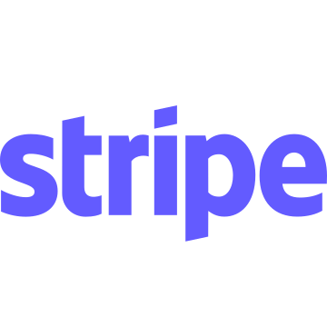

# AI support desk

**A triage agent, four specialists and a judge on every ticket.**

**The problem.** Support answers the same questions all day, the hard tickets wait behind them, and nobody checks what was actually sent.

**What this does about it.** Each ticket is triaged, answered by an agent that looks the facts up, judged by a second model, and audited overnight. Refunds follow a written policy and uncertain tickets reach a person with the facts attached.

One canvas of 93 nodes, 14 tested behaviours. Import the [reliability kit](../../shared) first: these workflows call it.

## AI support desk · Triage, specialists and a judge

A triage agent routes each Zendesk ticket to a specialist agent that can read Shopify, Stripe or the knowledge base. A separate judge checks every answer before it is sent, refunds are decided by a written policy in code, and anything uncertain reaches a person with the facts already gathered.

- **Starts from:** Zendesk event, Schedule, Typeform event
- **Platforms:**  Zendesk &nbsp;·&nbsp;  OpenAI &nbsp;·&nbsp;  Claude &nbsp;·&nbsp;  Shopify &nbsp;·&nbsp;  Supabase &nbsp;·&nbsp;  Stripe &nbsp;·&nbsp;  Pinecone &nbsp;·&nbsp;  Slack &nbsp;·&nbsp;  Typeform
- **Nodes:** 93
- **Calls:** `idempotency-guard`, `notify`, `error-handler`
- **Files:** [`ai-support-desk.json`](ai-support-desk.json) · [`ai-support-desk.workflow.ts`](ai-support-desk.workflow.ts)

```mermaid
flowchart LR
  n1ddv9wz(["New ticket"])
  nqcyqn2["Read the ticket"]
  nknbhbj[["Seen this ticket?"]]
  n13akdyk{"New ticket?"}
  n15km3ql["Already handled"]
  n18hit4w[["Triage agent"]]
  n12lq7ax("GPT · triage")
  n28xsgr("Triage")
  nztunlf["Apply the triage rules"]
  n1wu2lzc["Tag the ticket"]
  n1ql9m2t{"Straight to a person?"}
  n1dxhoev["Skip the agents"]
  nk1b3ac{"Which specialist?"}
  n15zhwbb["To the orders agent"]
  nj5569f["To the billing agent"]
  nj2c1w5["To the technical agent"]
  nilgp7k["To the general agent"]
  nqujyk1[["Orders agent"]]
  n14lbq21("Claude · orders")
  n1f31tw2("Orders answer")
  n1gbsyer("Order lookup")
  n1x12ewr("Order history")
  n1b3phll[["Billing agent"]]
  n1wzh0l3("Claude · billing")
  n13osqga("Billing answer")
  n1tds9en("Charge lookup")
  ng5l2id("Customer lookup")
  nh42108("Days since")
  n1321z0b[["Technical agent"]]
  nh5sh09("Claude · technical")
  n3cvw20("Technical answer")
  n1htyzgz("Help centre")
  n1bvxsxg("Embeddings · help centre")
  n1g0g56g("Work it through")
  n1ak10jq[["General agent"]]
  n1xh56sk("Claude · general")
  nmqq1ul("General answer")
  n88ho6h("Policies and guides")
  n1n35nxy("Embeddings · policies")
  n1hn79m2["Collect the answer"]
  nxbwy0v{"Refund asked for?"}
  nzokvbo["Past refunds"]
  npc4she["Apply the refund policy"]
  n1spafoh{"Inside the policy?"}
  n13d11l3[/"Refund in Stripe"/]
  n1qn7jj["Record the refund"]
  nkiflop["Add the refund to the reply"]
  nhvbzzs["Refund needs a person"]
  n1eq7x9x[["Judge agent"]]
  n1kuigfj("GPT · judging")
  nm071le("Verdict")
  n1y49fu3["Decide: send or hand over"]
  nbv96lk{"Fit to send?"}
  nk7j93e["Send the reply"]
  n1ybcubk["Log: answered"]
  ns1luoq["Write the handover"]
  nvejmnb["Assign to the team"]
  n1r6z55v["Log: handed over"]
  nz10vkh["Handover message"]
  nh6pmw5[["Tell the support team"]]
  n1jrt6ay(["Every 10 minutes"])
  n57k2ea["Open, unanswered tickets"]
  n1cbs8tt["Measure against the SLA"]
  nwdoov7["Mark the stage"]
  n1p40d54["SLA message"]
  nwxn4ke[["Raise the SLA"]]
  ncg1p3q(["02:00 nightly"])
  n1ucd33w["Yesterday's answers"]
  niewe0r["Take a sample"]
  n18h0srg[["Auditor agent"]]
  n91d90r("Claude · auditing")
  n4gflsg("Grade")
  n4hrwuh["Gather the grades"]
  nqq5x0w["Save the audit"]
  nswx9sj["Post the audit"]
  n1pl2pmx(["Monday 08:00"])
  n10urxvh["Handed over last week"]
  n1b0gn8g["Gather the questions"]
  ne9k16v{"Any gaps?"}
  nvsybxl[["Gaps agent"]]
  n1a33o69("Claude · gaps")
  nsfiued["Post the gaps"]
  nxl0tpx["Post all clear"]
  n1srs3j0(["Survey answered"])
  nq2sgbw["Read the survey"]
  nkoxeez["Record the score"]
  n1ycx1lr{"Unhappy?"}
  n2enfz5[["Recovery agent"]]
  n1epkxuh("Claude · recovery")
  n1m132x5["Open a follow-up"]
  nc0achz["Unhappy message"]
  nh6kizo[["Tell the support lead"]]
  n1qqb9av["Recorded"]
  n1ddv9wz --> nqcyqn2
  nqcyqn2 --> nknbhbj
  nknbhbj --> n13akdyk
  n13akdyk -->|yes| n18hit4w
  n18hit4w --> nztunlf
  nztunlf --> n1wu2lzc
  n1wu2lzc --> n1ql9m2t
  n1ql9m2t -->|yes| n1dxhoev
  n1dxhoev --> ns1luoq
  n13akdyk -->|no| n15km3ql
  n1ql9m2t -->|no| nk1b3ac
  nk1b3ac -->|yes| n15zhwbb
  n15zhwbb --> nqujyk1
  nqujyk1 --> n1hn79m2
  nk1b3ac -->|no| nj5569f
  nj5569f --> n1b3phll
  n1b3phll --> n1hn79m2
  nk1b3ac -->|no| nj2c1w5
  nj2c1w5 --> n1321z0b
  n1321z0b --> n1hn79m2
  nk1b3ac -->|no| nilgp7k
  nilgp7k --> n1ak10jq
  n1ak10jq --> n1hn79m2
  n1hn79m2 --> nxbwy0v
  nxbwy0v -->|yes| nzokvbo
  nzokvbo --> npc4she
  npc4she --> n1spafoh
  n1spafoh -->|yes| n13d11l3
  n13d11l3 --> n1qn7jj
  n1qn7jj --> nkiflop
  nkiflop --> n1eq7x9x
  nxbwy0v -->|no| n1eq7x9x
  n1spafoh -->|no| nhvbzzs
  nhvbzzs --> ns1luoq
  n13d11l3 -->|failed| nhvbzzs
  n1eq7x9x --> n1y49fu3
  n1y49fu3 --> nbv96lk
  nbv96lk -->|yes| nk7j93e
  nk7j93e --> n1ybcubk
  nbv96lk -->|no| ns1luoq
  ns1luoq --> nvejmnb
  nvejmnb --> n1r6z55v
  n1r6z55v --> nz10vkh
  nz10vkh --> nh6pmw5
  n1jrt6ay --> n57k2ea
  n57k2ea --> n1cbs8tt
  n1cbs8tt --> nwdoov7
  nwdoov7 --> n1p40d54
  n1p40d54 --> nwxn4ke
  ncg1p3q --> n1ucd33w
  n1ucd33w --> niewe0r
  niewe0r --> n18h0srg
  n18h0srg --> n4hrwuh
  n4hrwuh --> nqq5x0w
  nqq5x0w --> nswx9sj
  n1pl2pmx --> n10urxvh
  n10urxvh --> n1b0gn8g
  n1b0gn8g --> ne9k16v
  ne9k16v -->|yes| nvsybxl
  nvsybxl --> nsfiued
  ne9k16v -->|no| nxl0tpx
  n1srs3j0 --> nq2sgbw
  nq2sgbw --> nkoxeez
  nkoxeez --> n1ycx1lr
  n1ycx1lr -->|yes| n2enfz5
  n2enfz5 --> n1m132x5
  n1m132x5 --> nc0achz
  nc0achz --> nh6kizo
  n1ycx1lr -->|no| n1qqb9av
  n12lq7ax -.-> n18hit4w
  n28xsgr -.-> n18hit4w
  n14lbq21 -.-> nqujyk1
  n1f31tw2 -.-> nqujyk1
  n1gbsyer -.-> nqujyk1
  n1x12ewr -.-> nqujyk1
  n1wzh0l3 -.-> n1b3phll
  n13osqga -.-> n1b3phll
  n1tds9en -.-> n1b3phll
  ng5l2id -.-> n1b3phll
  nh42108 -.-> n1b3phll
  nh5sh09 -.-> n1321z0b
  n3cvw20 -.-> n1321z0b
  n1htyzgz -.-> n1321z0b
  n1bvxsxg -.-> n1htyzgz
  n1g0g56g -.-> n1321z0b
  n1xh56sk -.-> n1ak10jq
  nmqq1ul -.-> n1ak10jq
  n88ho6h -.-> n1ak10jq
  n1n35nxy -.-> n88ho6h
  n1kuigfj -.-> n1eq7x9x
  nm071le -.-> n1eq7x9x
  n91d90r -.-> n18h0srg
  n4gflsg -.-> n18h0srg
  n1a33o69 -.-> nvsybxl
  n1epkxuh -.-> n2enfz5
```

**How it runs**

1. **A ticket is opened.** Zendesk sends it in. A ticket seen before is not answered twice.
2. **A triage agent reads it.** Topic, urgency, sentiment and language. It is told not to answer.
3. **Some tickets always get a person.** Legal language, an angry customer, an enterprise account or another language: code sends these straight to the team, whatever the model thought.
4. **The rest go to a specialist.** Four agents, each with only the tools its job needs.
5. **Orders: it looks the order up.** The agent reads the order and the customer's history from Shopify and Supabase before it writes a word.
6. **Billing: it reads the charge.** It can look at Stripe. It cannot refund: it can only say a refund was asked for.
7. **Technical and general: from the documents.** Both search the knowledge base in Pinecone and must name the articles they used.
8. **A refund is decided by a written policy.** Under 100, not a third refund, not already refunded. Inside the policy, Stripe refunds it with an idempotency key. Outside, a person decides.
9. **A judge checks the answer.** A different model, which did not write the reply, checks every statement against the facts the specialist gathered.
10. **Code makes the final call.** Low confidence, a rejected verdict, a promise, a card number or a judge that could not be reached all mean the same thing: do not send.
11. **Sent, and logged.** The reply goes out through Zendesk and the answer is recorded for the nightly audit.
12. **Or handed over with everything attached.** The team gets the reasons, the facts found and the unsent draft as a private note, so nobody starts from zero.
13. **Tickets waiting on people are watched.** Every ten minutes, anything near or past its response time is raised once per stage.
14. **Every night, the agents are audited.** Every answer that moved money and a sample of the rest are graded by a separate agent. Poor grades are named in Slack.
15. **Every Monday, the gaps become a to-do list.** What the agents could not answer is grouped into themes, each with the article, tool or policy that would fix it.
16. **An unhappy customer gets a person.** A low survey score opens a follow-up with a draft note. The agent writes the draft; a person decides what is sent.

**Tested behaviour**

- an order question is looked up in Shopify, judged and answered
- legal language goes straight to a person and no specialist is asked
- a small refund inside the policy is made in Stripe and added to the reply
- a refund over the limit is never made by the agents
- an answer the judge rejects is handed over with the unsent draft
- a promise is caught in code even when the judge passes it
- a technical question is answered from the knowledge base
- with the models down, the ticket still reaches a person
- the same ticket delivered twice is answered once
- the nightly audit grades every refunded answer and names the poor ones
- Monday's gaps are grouped and posted
- a week with no handovers posts an all clear without a model call
- an unhappy survey opens a follow-up with a draft for a person
- a happy survey is only recorded
