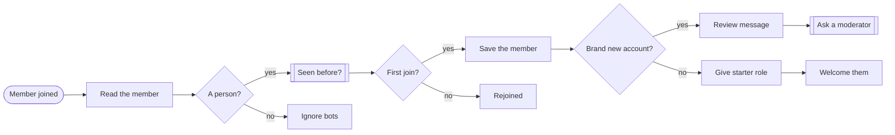
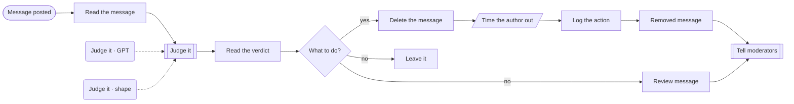
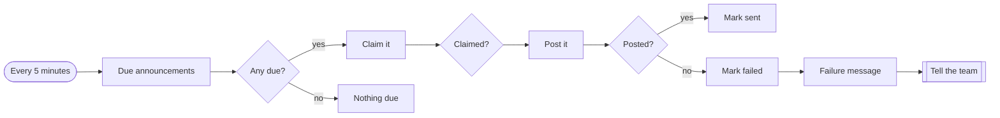

# Community operations

**Welcoming, moderating and announcing on a Discord server.**

**The problem.** A growing server needs someone awake at all hours to welcome people and remove scams.

**What this does about it.** Members are onboarded, scams are removed in seconds, and moderators are only asked about the cases that need judgement.

3 workflows, 12 tested behaviours. Import the [reliability kit](../../shared) first: these workflows call it.

## Community ops · Member onboarding

Welcomes a new member, gives them the starter role, records them, and flags accounts created minutes ago for a moderator to look at.

- **Starts from:** Webhook
- **Platforms:**  Supabase &nbsp;·&nbsp;  Discord
- **Nodes:** 13
- **Calls:** `idempotency-guard`, `notify`, `error-handler`
- **Files:** [`community-onboarding.json`](community-onboarding.json) · [`community-onboarding.workflow.ts`](community-onboarding.workflow.ts)

**How it runs**

1. **Someone joins.** Bots are ignored, and a person who left and came back is not welcomed twice.
2. **They are recorded.** With the age of their account, which is the cheapest spam signal there is.
3. **Normal accounts get in.** The starter role opens the channels, then a welcome points them at the first two.
4. **Day-old accounts wait.** No role is given. A moderator is asked to look first.

**Tested behaviour**

- a normal account is given the role and welcomed
- a day-old account is held for a moderator
- a bot is ignored
- a rejoin is not welcomed again

## Community ops · Message moderation

Checks each message, removes clear scams, sends borderline ones to moderators, and never removes anything when the model is unavailable.

- **Starts from:** Webhook
- **Platforms:**  OpenAI &nbsp;·&nbsp;  Discord &nbsp;·&nbsp;  Supabase
- **Nodes:** 14
- **Calls:** `notify`, `error-handler`
- **Files:** [`community-moderation.json`](community-moderation.json) · [`community-moderation.workflow.ts`](community-moderation.workflow.ts)

**How it runs**

1. **A message is posted.** Messages from bots and from the moderators themselves are skipped.
2. **A model judges it.** Allow, review or remove, with a reason. Criticism is explicitly allowed.
3. **Clear scams are removed.** The message is deleted, the author is timed out for an hour, and the action is logged with the original text.
4. **Anything unsure goes to people.** That includes every message judged while the model is down. The automation never removes on a guess.
5. **Everything else is left alone.** Which is most messages.

**Tested behaviour**

- a scam link is removed, logged and reported
- an insult goes to moderators and is not deleted
- an ordinary message is left alone
- nothing is removed while the model is down
- a moderator's message is not judged

## Community ops · Scheduled announcements

Posts announcements at the time they were scheduled for, once, and reports any that could not be posted.

- **Starts from:** Schedule
- **Platforms:**  Supabase &nbsp;·&nbsp;  Discord
- **Nodes:** 12
- **Calls:** `notify`, `error-handler`
- **Files:** [`community-announcements.json`](community-announcements.json) · [`community-announcements.workflow.ts`](community-announcements.workflow.ts)

**How it runs**

1. **Every five minutes.** It asks for announcements whose time has come.
2. **Each one is claimed first.** The status moves from scheduled to sending in one update that only succeeds once, so overlapping runs cannot double post.
3. **Posted and marked.** Sent announcements keep the time they actually went out.
4. **A failure is visible.** It is marked failed and the team is told, instead of silently retrying an hour late.

**Tested behaviour**

- a due announcement is posted once and marked sent
- a future announcement waits
- a failed post is marked and reported
