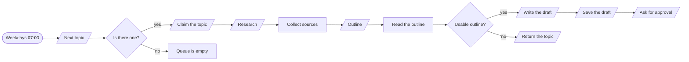
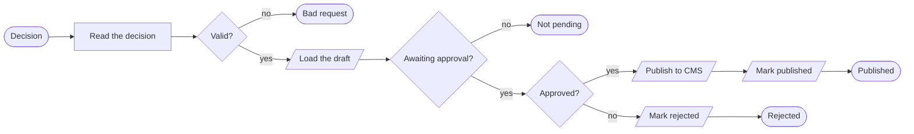
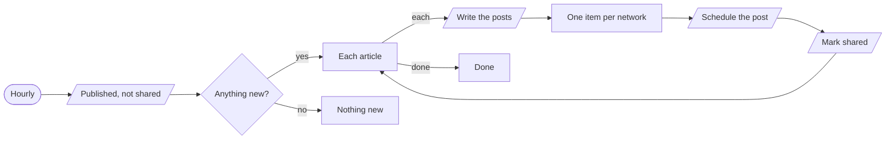

# Content pipeline

**Topic to published article, with a person's approval in the middle.**

**The problem.** Publishing regularly needs research, drafting, review and sharing, and one of them always slips.

**What this does about it.** A researched draft is ready each morning. Nothing is published until a person approves it, and sharing follows by itself.

3 workflows, 11 tested behaviours. Import the [reliability kit](../../shared) first: these workflows call it.

## Content pipeline · Research and draft

Takes the next topic off the list, researches it, drafts the article, and asks a person to approve it. Nothing is published from here.

| | |
|---|---|
| Starts from | Schedule |
| Talks to | Datastore, Search, LLM, Chat |
| Calls | `error-handler` |
| Files | [`content-draft.json`](content-draft.json) · [`content-draft.workflow.ts`](content-draft.workflow.ts) |

**How it runs**

1. **One topic a day.** The next queued topic is claimed, so two runs can never draft the same one.
2. **Research before writing.** A search gathers sources. The model is told to use only what is in them.
3. **Outline, then a check.** A thin or unreadable outline sends the topic back for a better brief instead of producing a weak article.
4. **The draft is written and saved.** It is stored as awaiting approval, with its sources.
5. **A person decides.** The content channel gets approve and reject buttons. Publishing is a separate workflow that only a person can start.

**Tested behaviour**

- drafts the queued topic and asks for approval
- does nothing when the queue is empty
- a thin outline sends the topic back

## Content pipeline · Approve and publish

Receives a person's decision on a draft. Approved drafts are published to the CMS once and queued for sharing; rejected ones go back with the reason.

| | |
|---|---|
| Starts from | Webhook |
| Talks to | Datastore, CMS, Chat |
| Calls | `error-handler` |
| Files | [`content-approval.json`](content-approval.json) · [`content-approval.workflow.ts`](content-approval.workflow.ts) |

**How it runs**

1. **A person presses a button.** Approve or reject, with who decided.
2. **The draft must still be pending.** A second click, or a click on an old message, gets a 409 and publishes nothing.
3. **Approved: published once.** The article goes to the CMS and the draft records who approved it and when.
4. **Rejected: kept with the reason.** Nothing is deleted, so the reason is there for the next attempt.

**Tested behaviour**

- approval publishes and records who approved
- rejection publishes nothing and keeps the reason
- approving twice publishes once
- an unknown draft is refused
- a malformed decision is a 400

## Content pipeline · Share what was published

Every hour, writes a post per network for anything newly published and schedules it. One network failing does not stop the others.

| | |
|---|---|
| Starts from | Schedule |
| Talks to | Datastore, LLM, Social |
| Calls | `error-handler` |
| Files | [`content-distribute.json`](content-distribute.json) · [`content-distribute.workflow.ts`](content-distribute.workflow.ts) |

**How it runs**

1. **It looks for new articles.** Published and not yet shared. The flag in the datastore is the only state.
2. **A post for each network.** The model writes three versions. If it fails, a plain title-and-link post is used instead.
3. **Scheduled, then marked.** Each network is scheduled on its own, so one outage costs one post and not all three.

**Tested behaviour**

- schedules three posts and marks the article shared
- uses a plain post when the model is down
- does nothing when nothing is new
