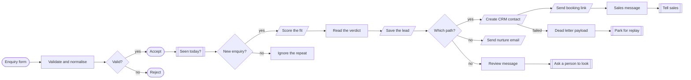
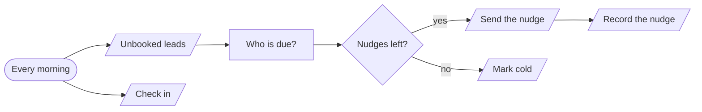
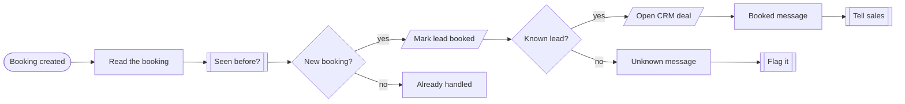

# Lead intake

**An enquiry followed from the form to a booked call.**

**The problem.** Enquiries arrive at any hour, sit in an inbox, and the good ones go cold before anyone replies.

**What this does about it.** Every enquiry is answered in seconds, scored, filed in the CRM and followed up until it books or goes cold.

3 workflows, 14 tested behaviours. Import the [reliability kit](../../shared) first: these workflows call it.

## Lead intake · Capture and qualify

Takes an enquiry from any form, rejects junk, ignores repeats, has a model score the fit, then files it in the CRM and sends the right first reply.

| | |
|---|---|
| Starts from | Webhook |
| Talks to | LLM, CRM, Email, Chat, Datastore |
| Calls | `idempotency-guard`, `notify`, `dead-letter`, `error-handler` |
| Files | [`lead-capture.json`](lead-capture.json) · [`lead-capture.workflow.ts`](lead-capture.workflow.ts) |

**How it runs**

1. **An enquiry arrives.** Any form can post here. Bad emails, empty messages and bots that fill the hidden field are turned away with a 400.
2. **The form gets its answer first.** The visitor sees success in milliseconds. Everything slower happens after the response.
3. **Repeats are ignored.** The same email on the same day is one enquiry, however many times the button was pressed.
4. **A model scores the fit.** It returns a score and a reason. If its reply cannot be read, the lead goes to a person rather than being guessed at.
5. **Three paths.** A fit goes to the CRM and gets a booking link. A poor fit gets a helpful email. Anything unclear is flagged for review.
6. **Sales is told, and nothing is lost.** If the CRM is down after three tries, the lead is parked for replay instead of disappearing.

**Tested behaviour**

- a good enquiry reaches the CRM and gets a booking link
- a poor fit gets the nurture email and no CRM record
- a bad email is rejected with a 400
- a bot filling the hidden field is rejected
- the same enquiry twice is handled once
- an unreadable model reply goes to a person
- a CRM outage parks the lead

## Lead intake · Follow up the unbooked

Each morning, writes to qualified leads who have not booked. Three nudges, two days apart, then the lead is marked cold and left alone.

| | |
|---|---|
| Starts from | Schedule |
| Talks to | Datastore, Email |
| Calls | `error-handler` |
| Files | [`lead-follow-up.json`](lead-follow-up.json) · [`lead-follow-up.workflow.ts`](lead-follow-up.workflow.ts) |

**How it runs**

1. **Every weekday morning.** It reads the qualified leads who have not booked, and checks in with the heartbeat monitor.
2. **Only the ones that are due.** Two days since the last contact. State lives in the datastore, so no workflow sits waiting for days.
3. **A nudge, then it is recorded.** Each of the three emails is different. The count is written back straight away.
4. **It knows when to stop.** After three, the lead is marked cold and never written to again.

**Tested behaviour**

- nudges a lead that is due and counts it
- leaves a lead contacted yesterday alone
- marks a lead cold after three nudges
- skips leads that already booked

## Lead intake · Booking sync

When a call is booked, moves the lead forward everywhere at once: the lead record, the CRM deal and the sales channel.

| | |
|---|---|
| Starts from | Webhook |
| Talks to | Calendar, Datastore, CRM, Chat |
| Calls | `idempotency-guard`, `notify`, `error-handler` |
| Files | [`lead-booking-sync.json`](lead-booking-sync.json) · [`lead-booking-sync.workflow.ts`](lead-booking-sync.workflow.ts) |

**How it runs**

1. **The calendar reports a booking.** Calendar tools resend webhooks, so the booking id is checked first.
2. **The lead moves forward.** The lead is marked booked, which is also what stops the follow-up emails.
3. **The CRM and the team catch up.** A deal opens at the right stage and sales sees it in the channel.
4. **Strangers are flagged.** A booking from someone who never enquired still gets noticed.

**Tested behaviour**

- a booking marks the lead and opens a deal
- a booking from a stranger is flagged
- a resent webhook is handled once
