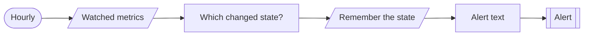

# Ops digest

**The week's numbers on one screen, and an alert when one breaks.**

**The problem.** The numbers exist in five tools and nobody has the hour it takes to gather them.

**What this does about it.** One summary every Monday with week-on-week change, and an alert the moment a number crosses its line.

2 workflows, 6 tested behaviours. Import the [reliability kit](../../shared) first: these workflows call it.

## Ops digest · Weekly summary

Every Monday, gathers the week's numbers from sales, orders, support and the site, compares them with the week before, and sends one readable summary.

| | |
|---|---|
| Starts from | Schedule |
| Talks to | Datastore, Analytics, LLM, Chat, Email |
| Calls | `error-handler` |
| Files | [`weekly-digest.json`](weekly-digest.json) · [`weekly-digest.workflow.ts`](weekly-digest.workflow.ts) |

```mermaid
flowchart LR
  n1pl2ppi(["Monday 08:30"])
  n4iy9xs[/"Leads"/]
  n1ywqmrw[/"Orders"/]
  n1kjyeo8[/"Support"/]
  nrusp7[/"Site traffic"/]
  n1caa1x9["Work out the week"]
  niart9r[/"Write the summary"/]
  nvx0wwb["Compose"]
  n16picrs[/"Post to the channel"/]
  n1u167cp[/"Email the owner"/]
  nuc14dg[/"Check in"/]
  n1pl2ppi --> n4iy9xs
  n4iy9xs --> n1ywqmrw
  n1ywqmrw --> n1kjyeo8
  n1kjyeo8 --> nrusp7
  nrusp7 --> n1caa1x9
  n1caa1x9 --> niart9r
  niart9r --> nvx0wwb
  nvx0wwb --> n16picrs
  n16picrs --> n1u167cp
  n1u167cp --> nuc14dg
```

**How it runs**

1. **Four sources, two weeks.** Leads, orders, support and site traffic. Each is allowed to fail on its own.
2. **The arithmetic is done in code.** This week against last week, per number. The model is never asked to count.
3. **A model writes four sentences.** It sees only the finished numbers and is told not to invent causes.
4. **It says what is missing.** A source that did not answer is named in the digest, not silently left out.
5. **Channel, inbox, heartbeat.** Posted, emailed, and checked in so a missed Monday is noticed.

**Tested behaviour**

- compares this week with last and sends both ways
- names a source that did not answer and still sends
- sends the numbers even when the model is down

## Ops digest · Threshold alerts

Checks each watched number hourly and alerts when it crosses its line, and again when it recovers. It does not repeat itself in between.

| | |
|---|---|
| Starts from | Schedule |
| Talks to | Datastore, Chat |
| Calls | `notify`, `error-handler` |
| Files | [`threshold-alerts.json`](threshold-alerts.json) · [`threshold-alerts.workflow.ts`](threshold-alerts.workflow.ts) |

**How it runs**

1. **Each number has a line.** A value, a threshold and a direction, kept in one table anyone can edit.
2. **Only a change of state matters.** Breached an hour ago and still breached is not news.
3. **One alert in, one alert out.** The team hears when it breaks and when it recovers, and nothing in between.

**Tested behaviour**

- alerts when a number crosses its line
- stays quiet while it is still breached
- says when it recovers
