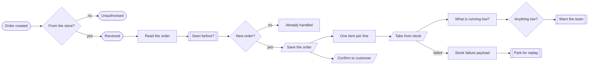
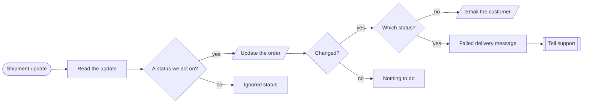
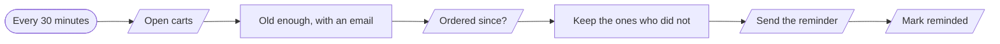

# Order operations

**An order followed from checkout to the customer's inbox.**

**The problem.** Orders, stock and customer emails live in different tools and are kept in step by hand.

**What this does about it.** Each order is recorded once, stock is taken, the customer is kept informed and abandoned carts are followed up.

3 workflows, 12 tested behaviours. Import the [reliability kit](../../shared) first: these workflows call it.

## Order ops · New order

Takes a new order from the store, records it once, takes its items out of stock, confirms to the customer, and warns the team about anything running low.

| | |
|---|---|
| Starts from | Webhook |
| Talks to | Shop, Datastore, Email, Chat |
| Calls | `idempotency-guard`, `notify`, `dead-letter`, `error-handler` |
| Files | [`order-intake.json`](order-intake.json) · [`order-intake.workflow.ts`](order-intake.workflow.ts) |

**How it runs**

1. **The store reports an order.** The request must carry the shared secret. Anything else gets a 401 and goes no further.
2. **It is recorded once.** Stores resend webhooks when they are unsure. The order id is claimed first, so stock is never taken twice.
3. **The customer hears straight away.** The confirmation does not wait for the stock work.
4. **Each line comes out of stock.** One call per line item, retried three times.
5. **Low stock is noticed at the moment it happens.** Anything at five or fewer becomes one message to the team.
6. **A stock failure is parked.** If the store's stock API stays down, the order is kept for replay with its lines.

**Tested behaviour**

- a new order is saved, confirmed and taken from stock
- low stock warns the team
- a resent order does not take stock twice
- a request without the secret is refused
- a stock outage parks the order

## Order ops · Shipping updates

Turns a courier status into the right message for the customer, and tells a person when a parcel fails delivery.

| | |
|---|---|
| Starts from | Webhook |
| Talks to | Datastore, Email, Chat |
| Calls | `notify`, `error-handler` |
| Files | [`order-fulfilment.json`](order-fulfilment.json) · [`order-fulfilment.workflow.ts`](order-fulfilment.workflow.ts) |

**How it runs**

1. **The courier reports.** Their many statuses are mapped to the four the business cares about. The rest are ignored.
2. **Only a real change counts.** The update only matches an order whose status is different, so a repeated event sends no second email.
3. **The customer is told.** Shipped, arriving today and delivered each have their own message.
4. **A failed delivery goes to a person.** The customer is not sent an automatic apology. Support is told to call them.

**Tested behaviour**

- a shipped update emails the customer
- the same update twice emails once
- a failed delivery goes to support, not the customer
- an unknown courier status is ignored

## Order ops · Abandoned cart recovery

Every half hour, writes once to people who left a cart over an hour ago and have not ordered since.

| | |
|---|---|
| Starts from | Schedule |
| Talks to | Datastore, Email |
| Calls | `error-handler` |
| Files | [`cart-recovery.json`](cart-recovery.json) · [`cart-recovery.workflow.ts`](cart-recovery.workflow.ts) |

**How it runs**

1. **It looks for open carts.** Not recovered and not yet reminded.
2. **An hour old, not three days.** Too soon is pushy and too late is pointless.
3. **It checks they did not buy anyway.** Someone who ordered from another device is not chased.
4. **One reminder, ever.** The cart is marked the moment the email goes.

**Tested behaviour**

- reminds an hour-old cart once
- leaves a ten-minute-old cart alone
- does not chase someone who ordered
