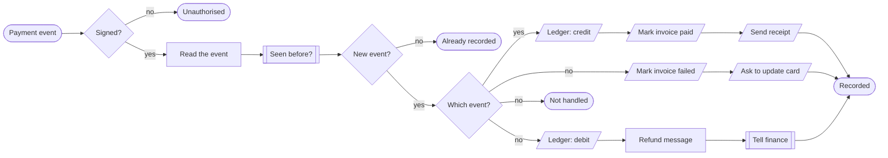
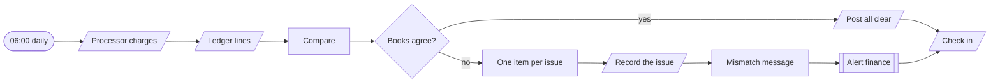
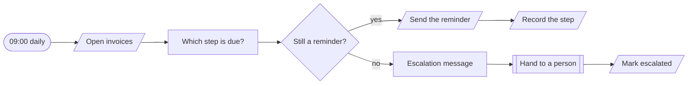

# Payments

**Every payment recorded exactly once, and checked daily.**

**The problem.** Payment webhooks arrive twice or not at all, and nobody notices the books are wrong until month end.

**What this does about it.** A ledger that matches the processor, a daily proof that it does, and overdue invoices chased on a schedule.

3 workflows, 14 tested behaviours. Import the [reliability kit](../../shared) first: these workflows call it.

## Payments · Event ledger

Records each payment, failure and refund from the processor exactly once, updates the invoice, and sends the receipt or the retry notice.

| | |
|---|---|
| Starts from | Webhook |
| Platforms | Datastore, Email, Chat |
| Nodes | 18 |
| Calls | `idempotency-guard`, `notify`, `error-handler` |
| Files | [`payment-events.json`](payment-events.json) · [`payment-events.workflow.ts`](payment-events.workflow.ts) |

**How it runs**

1. **The processor reports an event.** Unsigned requests are refused. The reply is only sent once the event is safely recorded, so the processor retries anything that was not.
2. **Exactly once.** Processors promise at-least-once delivery. The event id is claimed first, so a repeat changes nothing.
3. **A payment.** Credited to the ledger, the invoice marked paid, a receipt sent.
4. **A failure.** The invoice is marked and the customer is asked to update their card.
5. **A refund.** A negative ledger line, and finance is told.
6. **The processor gets its answer.** Events the business does not act on are acknowledged and ignored.

**Tested behaviour**

- a payment is credited, the invoice paid and a receipt sent
- the same event twice is one ledger line
- a refund is a negative line and finance is told
- a failed payment marks the invoice and asks for a new card
- an unsigned request is refused
- an event we do not act on is acknowledged

## Payments · Daily reconciliation

Each morning, compares yesterday's charges at the processor with the ledger and reports anything on one side and not the other.

| | |
|---|---|
| Starts from | Schedule |
| Platforms | Payments, Datastore, Chat |
| Nodes | 11 |
| Calls | `notify`, `error-handler` |
| Files | [`payment-reconcile.json`](payment-reconcile.json) · [`payment-reconcile.workflow.ts`](payment-reconcile.workflow.ts) |

**How it runs**

1. **Two lists of yesterday.** What the processor says it charged, and what the ledger says was recorded.
2. **Compared line by line.** Three things can be wrong: missing from the ledger, missing at the processor, or a different amount.
3. **A clean day says so.** Finance gets a one-line confirmation, which is also proof the check ran.
4. **A mismatch is recorded and raised.** Each issue is stored as open, then finance gets one critical alert naming them.
5. **It checks in.** If this ever stops running, the heartbeat monitor notices.

**Tested behaviour**

- matching books post an all clear
- a charge missing from the ledger is raised
- a different amount is raised
- a ledger line with no charge is raised

## Payments · Overdue reminders

Each morning, reminds customers with overdue invoices at 3, 7 and 14 days, then hands the invoice to a person at 21.

| | |
|---|---|
| Starts from | Schedule |
| Platforms | Datastore, Email, Chat |
| Nodes | 9 |
| Calls | `notify`, `error-handler` |
| Files | [`invoice-dunning.json`](invoice-dunning.json) · [`invoice-dunning.workflow.ts`](invoice-dunning.workflow.ts) |

**How it runs**

1. **It reads the open invoices.** Paid invoices never appear here, because the payment workflow marks them the moment money arrives.
2. **It works out the step.** 3, 7, 14 or 21 days overdue. A step already sent is never sent again, even if a day's run was missed.
3. **A reminder, recorded.** Each step has its own wording, and the step is written back.
4. **At 21 days a person takes over.** Automation stops and finance is asked to call.

**Tested behaviour**

- an invoice 8 days overdue gets the 7-day reminder
- a step already sent is not sent again
- an invoice not yet due is left alone
- at 21 days it is handed to a person
