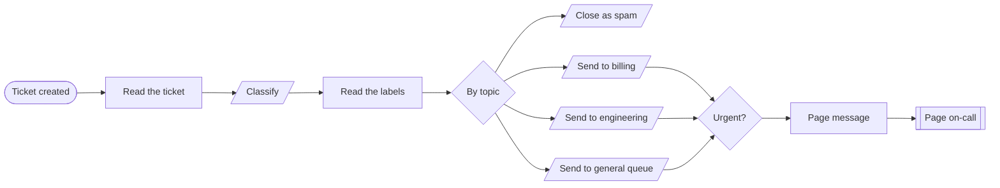
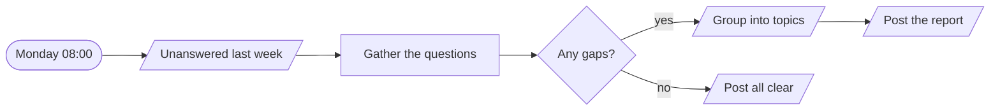

# Support agent

**Answers what it can, hands over what it cannot.**

**The problem.** The same questions are answered by hand every day, and the hard ones wait behind them.

**What this does about it.** Covered questions are answered from the help centre at once. Everything else reaches a person with the context already written.

3 workflows, 11 tested behaviours. Import the [reliability kit](../../shared) first: these workflows call it.

## Support agent · Answer or hand over

Answers a customer's message from the help centre when it is confident, and hands the conversation to a person with a summary when it is not.

| | |
|---|---|
| Starts from | Webhook |
| Platforms | Helpdesk, LLM, Datastore, Chat |
| Nodes | 16 |
| Calls | `idempotency-guard`, `error-handler` |
| Files | [`support-answer.json`](support-answer.json) · [`support-answer.workflow.ts`](support-answer.workflow.ts) |

```mermaid
flowchart LR
  n1aodkap(["Message received"])
  n2grn5h["Read the message"]
  n1ja4syq[["Seen before?"]]
  n15x6d6n{"New message?"}
  n19sycpm[/"Search the help centre"/]
  n1vchxqf["Build the context"]
  nb8srwr[/"Draft an answer"/]
  nlz0nj["Read the draft"]
  n1fqwg62{"Confident?"}
  nk7j93e[/"Send the reply"/]
  n12fjapb[/"Hand to a person"/]
  n1hpt4hq[/"Leave a private note"/]
  n1voqbr8["Answered"]
  ny2qpjz["Handed over"]
  n196wgcg[/"Log the outcome"/]
  n1ntcjch["Ignore the repeat"]
  n1aodkap --> n2grn5h
  n2grn5h --> n1ja4syq
  n1ja4syq --> n15x6d6n
  n15x6d6n -->|yes| n19sycpm
  n19sycpm --> n1vchxqf
  n1vchxqf --> nb8srwr
  nb8srwr --> nlz0nj
  nlz0nj --> n1fqwg62
  n1fqwg62 -->|yes| nk7j93e
  nk7j93e --> n1voqbr8
  n1voqbr8 --> n196wgcg
  n15x6d6n -->|no| n1ntcjch
  n1fqwg62 -->|no| n12fjapb
  n12fjapb --> n1hpt4hq
  n1hpt4hq --> ny2qpjz
  ny2qpjz --> n196wgcg
```

**How it runs**

1. **A customer writes in.** The helpdesk sends every message here. The agent's own replies and repeats are dropped.
2. **It looks things up first.** The help centre is searched and the best four articles become the only thing the model may answer from.
3. **It drafts, with a confidence.** The model returns an answer, its sources and whether a person should take over.
4. **Confident: it replies.** Above the threshold, the answer goes to the customer.
5. **Not confident: a person takes over.** The conversation is assigned with a private note, so nobody has to ask the customer to repeat themselves.
6. **Every outcome is logged.** Answered or handed over, it is recorded. That log is what the weekly gap report reads.

**Tested behaviour**

- answers a covered question
- hands over what the help centre does not cover
- hands over an upset customer even when the answer is known
- hands over when the model is unavailable
- ignores its own outgoing replies

## Support agent · Ticket triage

Labels each new ticket by topic and urgency, routes it to the right team, and pages someone only when it is urgent.

| | |
|---|---|
| Starts from | Webhook |
| Platforms | LLM, Helpdesk, Chat |
| Nodes | 12 |
| Calls | `notify`, `error-handler` |
| Files | [`support-triage.json`](support-triage.json) · [`support-triage.workflow.ts`](support-triage.workflow.ts) |

**How it runs**

1. **A ticket is opened.** Subject and body are read. Nothing else about the customer is sent to the model.
2. **A model labels it.** Topic, urgency and sentiment. If the reply cannot be read, the ticket goes to the general queue marked for review.
3. **It lands with the right team.** Spam is closed. Billing, engineering and general each get their own queue.
4. **Only urgent tickets page someone.** Everything else waits its turn in the queue.

**Tested behaviour**

- a billing ticket goes to billing without paging
- an urgent outage pages on-call
- spam is closed and nobody is paged
- an unreadable model reply falls back to the general queue for review

## Support agent · Weekly gap report

Every Monday, reads what the agent could not answer last week and tells the team which help articles are missing.

| | |
|---|---|
| Starts from | Schedule |
| Platforms | Datastore, LLM, Chat |
| Nodes | 7 |
| Calls | `error-handler` |
| Files | [`support-gap-report.json`](support-gap-report.json) · [`support-gap-report.workflow.ts`](support-gap-report.workflow.ts) |

**How it runs**

1. **Monday morning.** It reads last week's log for conversations that went to a person.
2. **Questions become topics.** A model groups them and names the article that is missing for each.
3. **The team gets a to-do list.** The report lands in the support channel. A clean week gets a short all-clear.

**Tested behaviour**

- reports the gaps
- says all clear when nothing was handed over
