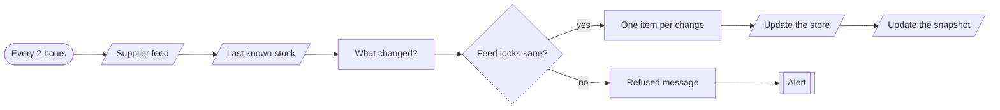
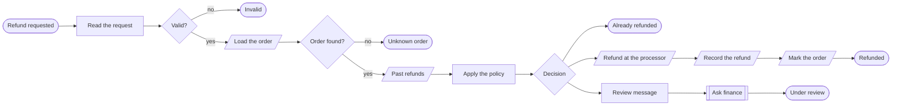
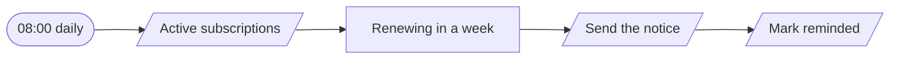
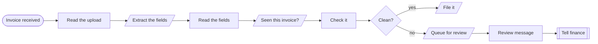

# Workflows · Commerce

4 workflows. Each one is tested against a real n8n; the cases are listed under it.

## Inventory · Supplier stock sync

Pulls the supplier's stock feed every two hours and updates the store only for products whose quantity changed, refusing a feed that looks wrong.

| | |
|---|---|
| Starts from | Schedule |
| Platforms | Supplier, Datastore, Shop, Chat |
| Nodes | 10 |
| Calls | `notify`, `error-handler` |
| Files | [`inventory-sync.json`](inventory-sync.json) · [`inventory-sync.workflow.ts`](inventory-sync.workflow.ts) |

**How it runs**

1. **The supplier's numbers, and ours.** The feed is compared with the last snapshot.
2. **A broken feed is refused.** An empty feed, or one that zeroes most of the catalogue, changes nothing and raises an alert. That one check is what stops a supplier outage from taking every product off sale.
3. **Only the differences are written.** Ten changed products means ten calls, not ten thousand.

**Tested behaviour**

- updates only what changed
- refuses an empty feed
- refuses a feed that zeroes most of the catalogue

## Payments · Refund requests

Refunds small amounts on recent orders automatically, and sends anything larger, older or repeated to a person with the facts attached.

| | |
|---|---|
| Starts from | Webhook |
| Platforms | Datastore, Payments, Email, Chat |
| Nodes | 18 |
| Calls | `notify`, `error-handler` |
| Files | [`refund-approval.json`](refund-approval.json) · [`refund-approval.workflow.ts`](refund-approval.workflow.ts) |

**How it runs**

1. **A refund is asked for.** The order is loaded, along with every refund this customer has had before.
2. **The policy is written down.** Under 100, within 30 days, and not a third refund. Each rule that fails is named.
3. **Inside the policy: refunded now.** The processor call carries an idempotency key, so a retry can never refund twice.
4. **Outside it: a person decides.** Finance gets the amount, the rules it failed and what the customer said.

**Tested behaviour**

- a small recent order is refunded automatically
- a large order goes to finance
- a third refund goes to finance
- asking twice refunds once
- an unknown order is a 404

## Subscriptions · Renewal reminders

Tells subscribers a week before an annual renewal, once, with the amount and the date, so the charge is never a surprise.

| | |
|---|---|
| Starts from | Schedule |
| Platforms | Datastore, Email |
| Nodes | 5 |
| Calls | `error-handler` |
| Files | [`renewal-reminder.json`](renewal-reminder.json) · [`renewal-reminder.workflow.ts`](renewal-reminder.workflow.ts) |

**How it runs**

1. **Annual plans only.** Monthly subscribers do not need a notice every month.
2. **Inside the last seven days.** The reminder is tied to the renewal date itself, so next year's renewal gets its own.
3. **One notice, with the amount.** And a link to change or cancel.

**Tested behaviour**

- reminds once for a renewal five days away
- a renewal a month away is left alone

## Finance · Supplier invoice intake

Reads a supplier invoice with a model, checks the arithmetic and the duplicate history itself, and files it or sends it for review.

| | |
|---|---|
| Starts from | Webhook |
| Platforms | LLM, Datastore, Chat |
| Nodes | 11 |
| Calls | `notify`, `error-handler` |
| Files | [`invoice-intake.json`](invoice-intake.json) · [`invoice-intake.workflow.ts`](invoice-intake.workflow.ts) |

**How it runs**

1. **An invoice arrives.** As text from the upload or the email it came in.
2. **A model reads the fields.** Vendor, number, total, due date, and how sure it is. It is told to return null and never to guess.
3. **Code checks the model's work.** Is the total a positive number? Is the date a date? Has this vendor sent this number before? None of that is left to the model.
4. **Clean invoices are filed.** Ready for the payment run.
5. **Anything doubtful goes to a person.** With the list of what was wrong, so the check takes seconds.

**Tested behaviour**

- a clean invoice is filed
- a duplicate is caught and sent for review
- low confidence goes for review
- a negative total goes for review
