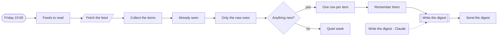
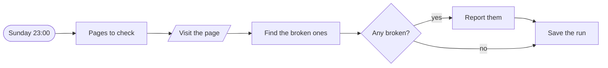
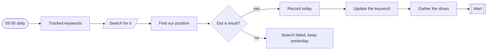
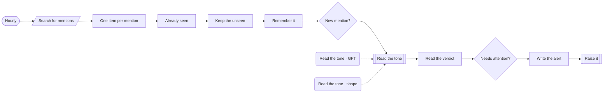

# Workflows · Content

4 workflows. Each one is tested against a real n8n; the cases are listed under it.

## Content · Industry news digest

Each Friday, reads the feeds you follow, drops what was already sent, and emails a short digest of what is new.

- **Starts from:** Schedule
- **Platforms:**  Supabase &nbsp;·&nbsp;  Claude &nbsp;·&nbsp;  SendGrid
- **Nodes:** 13
- **Calls:** `error-handler`
- **Files:** [`feed-digest.json`](feed-digest.json) · [`feed-digest.workflow.ts`](feed-digest.workflow.ts)

**How it runs**

1. **It reads your feeds.** One dead feed does not stop the others.
2. **Seen once, sent once.** The links already sent are read from Supabase. Only the ones that are new go forward, and they are remembered before the digest is written.
3. **A digest, or the plain list.** If the model is down the raw list is sent instead of nothing.

**Tested behaviour**

- sends only items not seen before
- sends nothing in a quiet week
- sends the plain list when the model is down

## SEO · Broken link check

Every Sunday night, visits each page in the sitemap list and reports the ones that no longer load, with the status each returned.

- **Starts from:** Schedule
- **Platforms:**  Supabase &nbsp;·&nbsp;  Slack
- **Nodes:** 7
- **Calls:** `error-handler`
- **Files:** [`broken-link-check.json`](broken-link-check.json) · [`broken-link-check.workflow.ts`](broken-link-check.workflow.ts)

**How it runs**

1. **Every page, once a week.** Each page is requested once. A page that errors is a result, not a crash.
2. **Broken means 4xx, 5xx or no answer.** Each broken page is listed with the status it returned.
3. **Reported, and the run is saved.** A clean week posts nothing, but the run is still recorded so the trend is there.

**Tested behaviour**

- reports a page that returns an error
- a clean site posts nothing and records the run

## SEO · Keyword rank tracker

Records where the site ranks for each tracked keyword every day, and alerts when one falls five places or drops off the first page.

- **Starts from:** Schedule
- **Platforms:**  Supabase &nbsp;·&nbsp;  SerpAPI
- **Nodes:** 10
- **Calls:** `notify`, `error-handler`
- **Files:** [`rank-tracker.json`](rank-tracker.json) · [`rank-tracker.workflow.ts`](rank-tracker.workflow.ts)

**How it runs**

1. **One search per keyword.** The top thirty results are fetched for each.
2. **Where are we?.** A failed search is not recorded as 'not ranking'. Yesterday's position is kept until a real answer arrives.
3. **History is kept.** Every day's position is stored, so the chart exists when someone asks for it.
4. **Drops are raised together.** Five places down, or off the first page. One message lists them all.

**Tested behaviour**

- records the position and alerts on a fall off page one
- a small move is recorded without an alert
- a failed search keeps yesterday's position

## Brand · Mention monitor

Checks hourly for new mentions of the brand, and raises the negative ones straight away with the text and the link.

- **Starts from:** Schedule
- **Platforms:**  SerpAPI &nbsp;·&nbsp;  Supabase &nbsp;·&nbsp;  OpenAI
- **Nodes:** 14
- **Calls:** `notify`, `error-handler`
- **Files:** [`mention-monitor.json`](mention-monitor.json) · [`mention-monitor.workflow.ts`](mention-monitor.workflow.ts)

**How it runs**

1. **New mentions, hourly.** The search overlaps the last run on purpose. Links already seen are read from Supabase and dropped, so overlap costs nothing.
2. **A model reads the tone.** A mention it could not read is treated as needing attention, not as fine.
3. **Negative ones are raised with the link.** Positive and neutral mentions are kept in Supabase and nobody is interrupted.

**Tested behaviour**

- raises a negative mention once
- a mention it cannot classify is raised too
