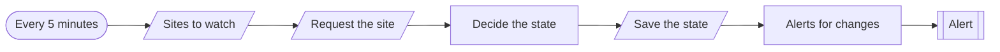
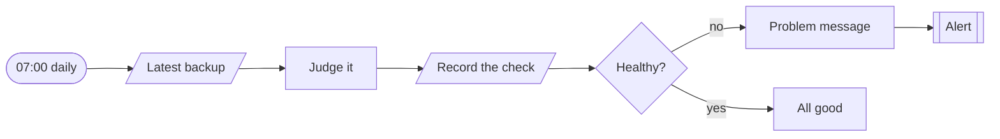

# Workflows · Monitoring

2 workflows. Each one is tested against a real n8n; the cases are listed under it.

## Monitoring · Uptime checks

Checks each site every five minutes, alerts after two failures in a row, and reports how long it was down once it recovers.

| | |
|---|---|
| Starts from | Schedule |
| Platforms | Datastore, Chat |
| Nodes | 7 |
| Calls | `notify`, `error-handler` |
| Files | [`uptime-monitor.json`](uptime-monitor.json) · [`uptime-monitor.workflow.ts`](uptime-monitor.workflow.ts) |

**How it runs**

1. **Each site is requested.** A timeout or an error is a result to record, not a crash.
2. **Two failures make an outage.** One bad response is noted and waited on. The second one in a row changes the state to down.
3. **Down, and back up.** One alert when it goes down, one when it recovers with how long it lasted. Nothing in between.

**Tested behaviour**

- one failure is noted without an alert
- a second failure in a row alerts
- recovery reports the downtime
- still down stays quiet

## Monitoring · Backup verification

Checks every morning that last night's backup exists, is recent and is not suspiciously small. A backup nobody checks is a hope, not a backup.

| | |
|---|---|
| Starts from | Schedule |
| Platforms | Backup, Chat, Datastore |
| Nodes | 8 |
| Calls | `notify`, `error-handler` |
| Files | [`backup-verify.json`](backup-verify.json) · [`backup-verify.workflow.ts`](backup-verify.workflow.ts) |

**How it runs**

1. **It asks for the newest backup.** If the backup service does not answer, that is itself the finding.
2. **Four ways a backup lies.** Missing, stale, not completed, or much smaller than yesterday's.
3. **Silence means it is fine.** Only a problem produces an alert. Every check is recorded either way.

**Tested behaviour**

- a fresh, full backup passes quietly
- a backup a third smaller raises an alert
- a stale backup raises an alert
- an unreachable backup service raises an alert
