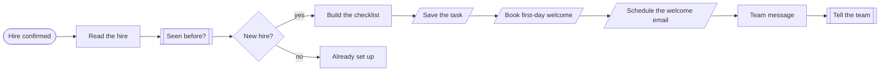
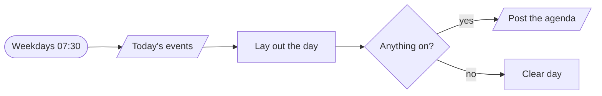
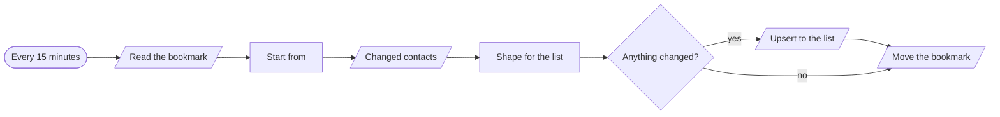
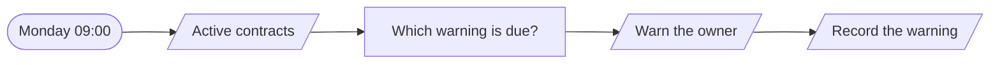

# Workflows · Operations

4 workflows. Each one is tested against a real n8n; the cases are listed under it.

## People · New hire onboarding

When someone is hired, creates their checklist, books their first-week meetings, tells the people who need to act, and sends the welcome email on the right morning.

| | |
|---|---|
| Starts from | Webhook |
| Platforms | Datastore, Calendar, Email, Chat |
| Nodes | 11 |
| Calls | `idempotency-guard`, `notify`, `error-handler` |
| Files | [`employee-onboarding.json`](employee-onboarding.json) · [`employee-onboarding.workflow.ts`](employee-onboarding.workflow.ts) |

**How it runs**

1. **A hire is confirmed.** HR systems send the same event on every edit, so the hire is set up once.
2. **A dated checklist.** Six tasks counted back from the start date, each with an owner. Remote hires get a shipped laptop, not a desk.
3. **The first morning is arranged.** A welcome meeting on the calendar and an email timed for 8am on day one.
4. **The people who must act are told.** One message, with the date.

**Tested behaviour**

- creates six tasks, a meeting and a timed welcome
- a hire without a start date fails loudly

## Calendar · Morning agenda

Posts today's meetings each weekday morning, with gaps and clashes pointed out, and stays silent on an empty day.

| | |
|---|---|
| Starts from | Schedule |
| Platforms | Calendar, Chat |
| Nodes | 6 |
| Calls | `error-handler` |
| Files | [`daily-agenda.json`](daily-agenda.json) · [`daily-agenda.workflow.ts`](daily-agenda.workflow.ts) |

**How it runs**

1. **Today's calendar.** Declined events are dropped.
2. **Laid out in order.** Total hours in meetings, and any two that overlap.
3. **One message, or none.** An empty day gets no message at all.

**Tested behaviour**

- lists the day and flags a clash
- stays silent on an empty day

## Data · CRM to email list sync

Copies contacts changed since the last run from the CRM to the email platform, page by page, and only moves its bookmark forward when a run finishes.

| | |
|---|---|
| Starts from | Schedule |
| Platforms | Datastore, CRM, Email |
| Nodes | 8 |
| Calls | `error-handler` |
| Files | [`contact-sync.json`](contact-sync.json) · [`contact-sync.workflow.ts`](contact-sync.workflow.ts) |

**How it runs**

1. **Where did we get to?.** A bookmark holds the time the last successful run started.
2. **Only what changed since.** Unsubscribes travel with the contact, so the email platform never mails someone the CRM says not to.
3. **The bookmark moves last.** If the upsert fails the bookmark stays put and the next run picks up the same contacts. Nothing is skipped.

**Tested behaviour**

- syncs changed contacts and moves the bookmark
- a failed upsert leaves the bookmark where it was

## Contracts · Expiry reminders

Warns the owner of each contract 60, 30 and 7 days before it ends, so renewals are a decision and never an accident.

| | |
|---|---|
| Starts from | Schedule |
| Platforms | Datastore, Email |
| Nodes | 5 |
| Calls | `error-handler` |
| Files | [`contract-expiry.json`](contract-expiry.json) · [`contract-expiry.workflow.ts`](contract-expiry.workflow.ts) |

**How it runs**

1. **Every active contract.** Supplier agreements, software licences, leases.
2. **Three warnings, each sent once.** 60, 30 and 7 days out. A missed week still sends the right one.
3. **The owner is told what matters.** Whether it renews by itself, and how much notice cancelling needs.

**Tested behaviour**

- sends the 30-day warning once
- a contract a year out is left alone
