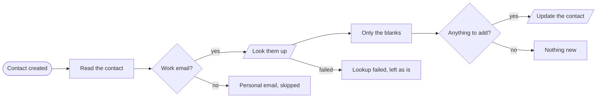
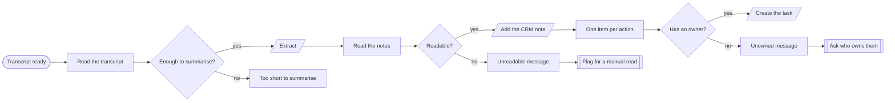
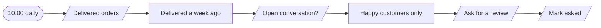
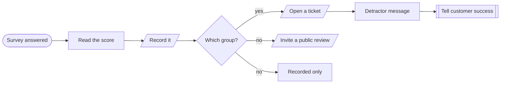
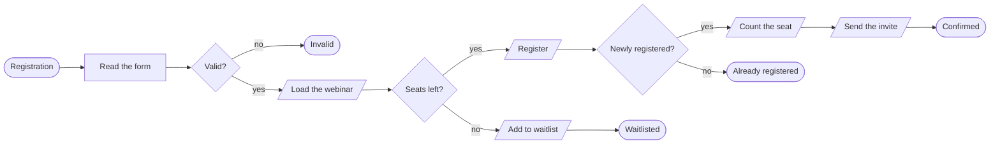

# Workflows · Sales

5 workflows. Each one is tested against a real n8n; the cases are listed under it.

## CRM · Enrich new contacts

Fills in company, role and size for a new CRM contact from an enrichment service, and never overwrites what a person already typed.

| | |
|---|---|
| Starts from | Webhook |
| Talks to | Enrichment, CRM |
| Calls | `error-handler` |
| Files | [`contact-enrichment.json`](contact-enrichment.json) · [`contact-enrichment.workflow.ts`](contact-enrichment.workflow.ts) |

**How it runs**

1. **A contact is created.** Personal email addresses are skipped: there is no company to find and the lookup costs money.
2. **They are looked up.** A failed lookup leaves the contact exactly as it was.
3. **Only blank fields are filled.** Anything a person already entered wins over the enrichment service.

**Tested behaviour**

- fills blanks and keeps what was typed
- skips a personal address without a lookup
- a failed lookup changes nothing

## CRM · Meeting notes and next steps

Turns a call transcript into a CRM note and dated follow-up tasks, and asks a person when it cannot tell who owns a task.

| | |
|---|---|
| Starts from | Webhook |
| Talks to | LLM, CRM, Chat |
| Calls | `notify`, `error-handler` |
| Files | [`meeting-notes-to-crm.json`](meeting-notes-to-crm.json) · [`meeting-notes-to-crm.workflow.ts`](meeting-notes-to-crm.workflow.ts) |

**How it runs**

1. **A call ends.** A transcript of a few words is a missed call, not a meeting, and is left alone.
2. **Summary, decisions, actions.** Extracted as structured data. An unreadable reply is flagged for a manual read.
3. **The deal gets its note.** The summary and decisions are attached to the deal.
4. **Actions become tasks.** Owned actions become dated tasks. Unowned ones are sent to the team to assign, in one message.

**Tested behaviour**

- writes the note, creates owned tasks and asks about unowned ones
- a near-empty transcript is left alone
- an unreadable reply is flagged

## Reviews · Ask after delivery

A week after an order is delivered, asks for a review once. Customers with an open support conversation are not asked.

| | |
|---|---|
| Starts from | Schedule |
| Talks to | Datastore, Email |
| Calls | `error-handler` |
| Files | [`review-request.json`](review-request.json) · [`review-request.workflow.ts`](review-request.workflow.ts) |

**How it runs**

1. **A week after delivery.** Long enough to have used it, recent enough to remember.
2. **Not while there is a complaint open.** Asking someone with an unresolved problem for a review is how bad reviews happen.
3. **Asked once.** The order is marked as soon as the email goes.

**Tested behaviour**

- asks once for a week-old delivery
- does not ask a customer with an open conversation
- waits for the week to pass

## Feedback · Route survey scores

Sends each survey score where it is useful: unhappy customers to a person today, happy ones to a review request, and every score to the record.

| | |
|---|---|
| Starts from | Webhook |
| Talks to | Datastore, Helpdesk, Email, Chat |
| Calls | `notify`, `error-handler` |
| Files | [`nps-router.json`](nps-router.json) · [`nps-router.workflow.ts`](nps-router.workflow.ts) |

**How it runs**

1. **A score comes in.** 0 to 10, with an optional comment. Every one is recorded before anything else.
2. **6 or under: a person, today.** A high-priority ticket and a message with the customer's own words.
3. **9 or 10: ask them to say it publicly.** The best moment to ask for a review is right after someone volunteers that they are happy.
4. **7 or 8: just the record.** No email, no ticket.

**Tested behaviour**

- a low score opens a ticket and tells the team
- a top score gets a review invite
- a middling score is only recorded
- an impossible score fails loudly

## Events · Webinar registration and reminders

Registers someone for a webinar, sends the calendar invite, and reminds them a day and an hour before. Full sessions get a waitlist reply.

| | |
|---|---|
| Starts from | Webhook |
| Talks to | Datastore, Email |
| Calls | `error-handler` |
| Files | [`webinar-registration.json`](webinar-registration.json) · [`webinar-registration.workflow.ts`](webinar-registration.workflow.ts) |

**How it runs**

1. **Someone registers.** The form gets a real answer: registered, already registered, waitlisted, or what was wrong.
2. **Seats are checked.** A full session puts the person on the waitlist instead of turning them away.
3. **One seat per person.** Registering twice takes one seat and sends one invite.
4. **The invite goes out.** With the calendar file, so it lands in their diary.

**Tested behaviour**

- registers, counts the seat and sends the invite
- registering twice takes one seat
- a full session waitlists
- a bad email is a 400
