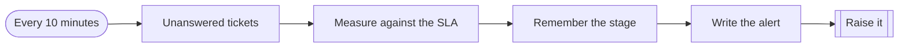
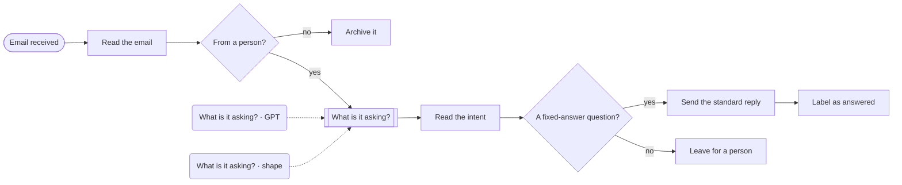

# Workflows · Support

2 workflows. Each one is tested against a real n8n; the cases are listed under it.

## Support · SLA breach watch

Every ten minutes, finds tickets about to miss their first-response time, warns the owner, and escalates the ones that already have. Each ticket is raised once per stage.

- **Starts from:** Schedule
- **Platforms:**  Zendesk
- **Nodes:** 6
- **Calls:** `notify`, `error-handler`
- **Files:** [`sla-watch.json`](sla-watch.json) · [`sla-watch.workflow.ts`](sla-watch.workflow.ts)

**How it runs**

1. **Tickets with no reply yet.** Checked every ten minutes.
2. **Measured against their own limit.** Urgent tickets have 30 minutes, low ones a day. Three quarters of the way there is 'at risk'.
3. **Raised once per stage.** The stage is written on the Zendesk ticket as a tag, so the next run stays quiet until it gets worse.

**Tested behaviour**

- warns at three quarters and escalates a miss
- does not repeat a stage already raised

## Support · Inbox triage and first reply

Sorts the shared inbox: answers the handful of questions that have a fixed answer, files newsletters and receipts, and leaves everything else for a person.

- **Starts from:** Gmail event
- **Platforms:**  Gmail &nbsp;·&nbsp;  OpenAI &nbsp;·&nbsp;  SendGrid &nbsp;·&nbsp;  Zendesk
- **Nodes:** 12
- **Calls:** `error-handler`
- **Files:** [`email-autoresponder.json`](email-autoresponder.json) · [`email-autoresponder.workflow.ts`](email-autoresponder.workflow.ts)

**How it runs**

1. **Mail arrives in the shared Gmail inbox.** Newsletters, receipts and bounces are spotted from their headers and archived without a model call.
2. **A model reads the rest.** It may pick one of three fixed-answer questions, and only when the email is plainly asking that.
3. **Fixed questions get the fixed answer.** The reply is a template a person wrote. The model chooses it and never writes it.
4. **Everything else becomes a ticket.** Including anything the model was unsure about, and everything when the model is down.

**Tested behaviour**

- a plain opening-hours question gets the template
- an unsure classification goes to a person
- a newsletter is archived without a model call
- everything goes to a person while the model is down
